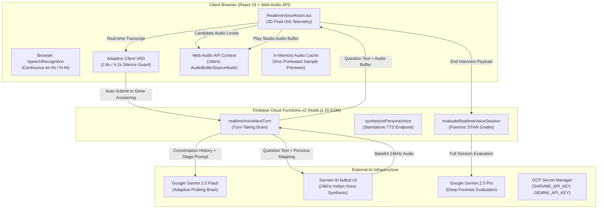

# 🎙️ AIVI CAMPUS OS — TWO-WAY REAL-TIME VOICE INTERVIEW STUDIO
## 🏛️ Comprehensive Architecture, Technical Inventory & World-Class Enhancement Brief
**Target Platform:** AIVI Campus OS (`aivicampus.com` / `staging.aivicampus.com`)  
**Parent Entity:** AIVI Intelligence Private Limited  
**Confidentiality Level:** Internal Engineering & Advisory Handover (For CTO, AI Architects & Advanced LLMs)  
**Version:** 3.0.0 (October 2026 Edition)  
**Primary Engine:** Google Gemini 2.5 Flash/Pro + Sarvam AI Bulbul v3 + Web Audio API Full-Duplex Studio  

---

## 1. 🌟 EXECUTIVE OVERVIEW & PLATFORM MOAT

### 1.1 The Strategic Problem We Solve
Over **80% of Indian engineering and college graduates** fail technical and behavioral job placement interviews (TCS, Accenture, Amazon, Flipkart, Infosys) not because of lack of coding knowledge, but because of:
1. **Verbal Articulation Anxiety**: Inability to articulate system architecture or code decisions under time pressure.
2. **Lack of STAR Structure**: Answering situational and behavioral questions without clear Situation-Task-Action-Result discipline.
3. **Pacing, Clarity & Filler Words**: Fast speech pacing (>170 WPM), hesitation pauses, and high density of regional filler words (`um`, `uh`, `matlab`, `basically`).
4. **Western AI Bias & Prohibitive Western Pricing**: Existing US platforms ($30–$50/mo) penalize Indian regional English accents and violate Indian **Digital Personal Data Protection (DPDP) Act 2023** data sovereignty mandates.

### 1.2 Our Core Moat
A sovereign, institutional B2B Higher-Education Employability OS delivering:
- **Authentic Indian Recruiter Personas**: Native conversational delivery in calibrated Indian English and bilingual Hinglish (Sarvam AI `bulbul:v3` speakers: Ananya, Vikram, Priya, Kabir).
- **Two-Way Conversational Turn-Taking**: AI listens, evaluates candidate responses, challenges weak answers, and asks relevant follow-up questions in real time.
- **Forensic Acoustic & Content Dossier**: Measures Words Per Minute (WPM), speech clarity %, filler word count, STAR rubric grading, technical depth rating (0–100), and generates a 7-Day Mastery Action Plan.
- **DPDP Act 2023 Compliance**: Zero audio recordings stored on disk; live in-memory processing only; sovereign cloud infrastructure.

---

## 2. 🏗️ CURRENT TECHNICAL ARCHITECTURE & STACK



### 2.1 Complete Tech Stack Breakdown

| Layer | Component | Technologies & Frameworks | Function in Voice Studio |
| :--- | :--- | :--- | :--- |
| **Frontend UI/UX** | Client Application | React 19, TypeScript 5.8, Tailwind CSS, Radix UI, Lucide Icons | Full-screen live conversational studio, responsive HUD, glowing fluid orb, floating subtitles. |
| **Audio Processing** | Web Audio API | `AudioContext` (24kHz), `AnalyserNode`, `AudioBufferSourceNode` | Low-latency audio streaming, 3D fluid orb acoustic frequency extraction, instant playback. |
| **Speech Recognition** | Client-Side ASR | Chromium `webkitSpeechRecognition` / `SpeechRecognition` (`en-IN`, `hi-IN`) | Continuous client-side speech-to-text without sending raw streaming PCM audio over HTTP. |
| **Voice Activity Detection** | Client VAD Logic | In-memory adaptive silence timer (2.8s for $\ge 12$ words, 4.2s for $< 12$ words) | Determines when the candidate has completed their answer to trigger the next turn automatically. |
| **Backend Compute** | Serverless Microservices | Firebase Cloud Functions v2 (Node.js 20 ESM, TypeScript) on `us-central1` | `realtimeVoiceNextTurn`, `synthesizePersonaVoice`, `evaluateRealtimeVoiceSession`. |
| **Conversational Brain** | LLM Engine | Google Gemini 2.5 Flash (`temperature: 0.6`, `maxOutputTokens: 120`) | Evaluates candidate answer substance, adapts to short/vague answers, and generates follow-ups. |
| **Voice Synthesis** | Indic Neural TTS | Sarvam AI `bulbul:v3` REST API (`https://api.sarvam.ai/text-to-speech`) | Studio-quality 24kHz Indian English and Hindi voice synthesis with distinct speakers. |
| **Evaluation Model** | Deep Reasoning LLM | Google Gemini 2.5 Pro (`generationConfig: { responseMimeType: "application/json" }`) | Forensic STAR grading, WPM calculation, filler word analysis, model answers, 7-day roadmap. |
| **Security & Secrets** | Cloud Secret Storage | Google Cloud Secret Manager (`projects/373888082997/secrets/`) | `SARVAM_API_KEY`, `GEMINI_API_KEY`, `BHASHINI_USER_ID`, `BHASHINI_API_KEY`. |
| **Hosting & Web Server** | Edge & VPS | Hostinger KVM Dedicated VPS (`187.127.134.92`), Nginx 1.24, Firebase Hosting | Static frontend bundle hosting with sub-millisecond reverse-proxy routing and HTTP/2. |

---

## 3. 👥 INTERVIEWER PERSONAS & ACOUSTIC PROFILES

The platform provides 4 calibrated Indian interviewer personas representing different corporate interview cultures:

| Persona | Name | Corporate Persona & Seniority | Questioning Style & Rigor | Sarvam bulbul:v3 Speaker | Language / Dialect |
| :--- | :--- | :--- | :--- | :--- | :--- |
| **Ananya** | Tech Lead & Manager (IT Services) | Accenture, TCS Digital, Infosys, Wipro Turbo | Structured, foundational Java/OOP, database SQL queries, articulate communication. | `kavya` | Indian English (`en-IN`) |
| **Vikram** | Principal SDE / Bar Raiser (Product Tech) | Amazon, Flipkart, Google, High-Growth Unicorns | Rigorous, challenges shallow answers, probes concurrency, scalability, and design trade-offs. | `aditya` | Indian English (`en-IN`) |
| **Priya** | Senior HR & People Partner | Global Consulting, Big 4, Leadership Development | Warm, behavioral dilemmas, conflict resolution, ownership, pressure scenarios. | `priya` | Indian English (`en-IN`) |
| **Kabir** | Senior Engineering Mentor | Startup Founder / Practical Engineering Coach | Friendly, conversational, bilingual Hinglish, helps nervous candidates open up. | `kabir` | Bilingual Hinglish (`hi-IN` / `en-IN`) |

---

## 4. 🔄 DETAILED STEP-BY-STEP WORKFLOW & CONVERSATIONAL CYCLE

### Phase 1: Pre-Interview Configuration (`PersonaVoicePickerModal.tsx`)
1. **Target Setup**: Candidate selects Target Company (e.g. *Accenture*, *Amazon*, *TCS*), Target Role (e.g. *Associate Software Engineer (Java)*), and optionally pastes a custom Job Description (JD).
2. **Persona Selection**: Candidate reviews the 4 personas.
3. **0ms Voice Preview ("Listen Sample")**:
   - *Previous Defect*: Clicking "Listen Sample" took ~3 seconds due to on-demand network roundtrips to Google Cloud and Sarvam AI.
   - *Current Implementation*: On modal mount, `prefetchPersonaSamples()` pre-warms all 4 persona samples into an in-memory `personaSampleAudioCache`. Clicking "Listen Sample" plays the decoded 24kHz Web Audio buffer in **0 milliseconds (instant)**.
4. **Environment Check**: Browser microphone stream is calibrated using an audio analyser loop ensuring input levels are healthy before launch.

---

### Phase 2: Live Room Launch (`RealtimeVoiceRoom.tsx`)
1. **Web Audio Context Initialization**: Creates `new AudioContext({ sampleRate: 24000 })`, connects an `AnalyserNode` for frequency telemetry, and starts real-time RMS calculations.
2. **Initial Question Audio Playback**:
   - The session initiates with the persona's role-tailored greeting:
     > *"Hello! Welcome to your Accenture Associate Software Engineer (Java) interview. To begin, could you introduce yourself and walk me through your key projects?"*
   - Pre-synthesized or synthesized via `synthesizePersonaVoice`.
3. **Acoustic Feedback & Self-Cancellation Safeguard**:
   - *Previous Defect*: Laptop speakers played the interviewer's voice into the laptop microphone. The client volume monitor interpreted this as candidate speech and killed audio within 100ms. Chrome speech recognition transcribed the question as candidate speech.
   - *Current Implementation*: While `isAiSpeaking` is active, candidate speech transcription is muted, and volume cutoff checks are disabled. The interviewer speaks smoothly to the end of the sentence without self-cancellation.

---

### Phase 3: Candidate Response & Turn-Taking Loop
1. **Speech Recognition**: Chromium `SpeechRecognition` streams live transcription chunks.
2. **3D Reactive Fluid Orb (`VoiceFluidOrb.tsx`)**:
   - Visualizes live audio waveforms using 3 dynamic concentric rings responding to real-time voice amplitude ($0\text{--}100$).
3. **Adaptive Silence VAD Guard**:
   - *Substantive Answers ($\ge 12$ words)*: A pause of **2.8 seconds** automatically triggers turn submission.
   - *Brief / Hesitant Answers ($< 12$ words)*: A pause of **4.2 seconds** is required before auto-submitting, ensuring natural thinking pauses don't cut off candidate answers prematurely.
   - *Manual Shortcut*: A high-contrast **`[✓ Done Answering]`** button allows candidates to immediately submit without waiting for the silence timer.

---

### Phase 4: Backend Next Turn Processing (`realtimeVoiceNextTurn`)
1. **Payload**: The client sends `{ sessionId, transcript, company, targetRole, personaId, language, strictness, turnIndex }`.
2. **Conversational Stage Mapping**:
   The interview progresses dynamically through 5 progressive industry stages:
   - **Stage 1**: Candidate Introduction & Core Projects Overview
   - **Stage 2**: Technical Architecture, DB Design & Tech Stack Trade-offs
   - **Stage 3**: System Scalability, Concurrency, Latency & Edge Cases
   - **Stage 4**: Problem Solving, Production Debugging & Team Conflict
   - **Stage 5**: Role Alignment, Company Fit & Candidate Closing
3. **Adaptive Probing Logic (Gemini 2.5 Flash)**:
   - *If Candidate Gives a Substantial Answer*: The model acknowledges the candidate's point in 1 concise sentence (validating or challenging a trade-off) and asks the next stage-focused question ($< 35$ words).
   - *If Candidate Gives a Brief / Vague Answer (< 12 words, e.g. "Yes, okay, I did this")*: The model directly and politely challenges the candidate:
     > *"That was quite brief. Could you specify which project you're referring to, what exact frameworks you used, and explain your concrete code implementation?"*
   - *Strict Negative Constraints*: The model is strictly prohibited from using repetitive formulaic openers like `"I am..."`, `"I understand..."`, or `"I'm glad..."`.
4. **Voice Synthesis**:
   - Passes the generated question text to `voiceEngine.tts()` using Sarvam `bulbul:v3`.
   - Returns base64 24kHz audio buffer directly in the turn payload.
5. **Instant Client Playback**:
   - `sessionRef.current.speakAudioWithText(res.audioBase64, nextQ)` decodes and plays the audio via Web Audio API immediately.

---

### Phase 5: Post-Interview Forensic Evaluation (`InterviewIntelligenceReport.tsx`)
When the 5 stages conclude (or candidate ends session), the complete multi-turn transcript is evaluated by **Gemini 2.5 Pro**:
1. **Employability Score Benchmark**: Weighted composite score ($0\text{--}100$) calibrated against company target hiring bars.
2. **Acoustic & Speech Telemetry**:
   - Words Per Minute (WPM): Evaluated against the 110–160 WPM optimal professional band.
   - Speech Clarity %: Sentence completeness and grammatical coherence.
   - Filler Word Density: Count of `um`, `uh`, `matlab`, `basically`, `like`, `you know`.
3. **STAR Rubric Grading**: Individual evaluation of Situation, Task, Action, and Result across each answer.
4. **Model Answers & Comparison**: Displays the candidate's actual answer side-by-side with an ideal senior engineer model answer.
5. **7-Day Mastery Action Plan**: Structured daily practice plan addressing weak technical areas.

---

## 5. 🔍 RECENT PROBLEMS DIAGNOSED & FIXED (LIVING KNOWLEDGE)

| Defect / Observation | Exact Root Cause | Permanent Resolution Deployed |
| :--- | :--- | :--- |
| **"Listen Sample" foreign US robot voice** | `geminiLiveService.ts` was falling back to `window.speechSynthesis`. On Windows/Chrome without local Indic packs, it defaulted to Microsoft David (US). | Routed previews through `synthesizePersonaVoice` using Sarvam AI `bulbul:v3` 24kHz audio via Web Audio API. |
| **"Listen Sample" 3-second delay** | Each click made an on-demand HTTPS roundtrip from India to `us-central1` Google Cloud $\rightarrow$ Sarvam API $\rightarrow$ India. | Built `personaSampleAudioCache` and `prefetchPersonaSamples()` preheating samples on modal mount. Playback is now **0ms (instant)**. |
| **Voice stopped suddenly / acoustic cutoff** | Laptop speakers played interviewer voice into laptop mic. Raw mic volume monitor (`normalizedLevel > 24`) killed audio within 100ms; speech recognition transcribed speaker audio. | Removed destructive volume cutoff from monitor loop; muted candidate speech recognition while `isAiSpeaking` is true. |
| **Candidate answer cut off prematurely** | Hardcoded 1.4-second silence timer on any speech $\ge 4$ words fired during natural mid-sentence thinking pauses. | Upgraded to adaptive VAD: **2.8s** for substantial answers ($\ge 12$ words), **4.2s** for brief answers ($< 12$ words), with `[✓ Done Answering]` shortcut. |
| **AI repetitively said "I am, I am, I am"** | `functions/src/index.ts` checked `ttsRes.audioBuffer` on a raw `Buffer` (which returned undefined), causing empty audio and client fallback stutters. Gemini also lacked instructions for brief answers. | Fixed `Buffer.isBuffer(ttsRes)` handling. Added active probing prompt for brief answers ($< 12$ words) and banned repetitive "I am..." openers. |
| **Rigid "Question 1 of 5" Multiple-Choice Framing** | Top HUD displayed test-like counter, treating the interview like a mechanical 5-question form rather than a real conversation. | Redesigned into **5 progressive industry stages** with real-time status ticker pills (`🔊 Speaking`, `🧠 Formulating`, `🟢 Listening`). |

---

## 6. 🚀 TECHNICAL DILEMMAS & QUESTIONS FOR THE CTO / EXTERNAL ARCHITECTS

To take this engine from a solid turn-based system to a **world-class, ultra-low-latency real-time voice intelligence platform**, we are soliciting architectural recommendations on the following key questions:

### 1. Architectural Topology: WebSockets / WebRTC vs HTTPS Turn-Based Calls
- **Current Setup**: Client records candidate speech via browser SpeechRecognition $\rightarrow$ sends completed turn via HTTPS Cloud Function $\rightarrow$ Gemini generates text $\rightarrow$ Sarvam synthesizes audio $\rightarrow$ client decodes Base64 buffer. Total turn latency: ~1.2s to 1.8s.
- **The Question**: Should we migrate to a persistent bidirectional streaming architecture (e.g. **WebSockets**, **LiveKit WebRTC**, or **Daily.co**)?
- **Trade-offs**:
  - *WebSockets / WebRTC*: Sub-500ms latency, true acoustic barge-in, token-by-token audio streaming. But higher server statefulness, VPS connection concurrency limits, and increased DevOps complexity.
  - *Current Cloud Functions*: Serverless, stateless, infinitely scalable to 10,000 simultaneous college students with zero server maintenance.
  - *What is the optimal hybrid architecture?*

### 2. Speech-to-Text (ASR): Client-Side Web Speech API vs Cloud Indic Streaming ASR
- **Current Setup**: Chromium `webkitSpeechRecognition` with `en-IN` / `hi-IN`.
- **The Problem**: Web Speech API is proprietary to Google Chromium (Chrome/Edge/Brave). It does not work reliably on Mozilla Firefox or Apple Safari (macOS/iOS).
- **The Question**: Should we pipe client microphone PCM audio chunks over WebSocket to:
  - **Sarvam AI Saarika v2** (Streaming Indic ASR)?
  - **Deepgram Nova-2** (World's fastest speech-to-text, ~250ms latency)?
  - **Self-hosted Whisper-large-v3-turbo** on our Hostinger GPU / KVM VPS?
  - What are the unit economics and bandwidth requirements for 5,000 concurrent student drives?

### 3. Sub-500ms End-to-End Latency: Sentence-Clause Streaming Pipeline
- **The Idea**: Instead of waiting for Gemini 2.5 Flash to generate the complete 35-word paragraph before calling Sarvam TTS:
  - As soon as the first complete clause (e.g. 6 to 8 words ending in a comma or period) streams from Gemini:
    ```
    Gemini token stream: "Makes sense." -> Pipe immediately to Sarvam TTS -> Browser plays AudioBuffer 1 (within 350ms).
    While AudioBuffer 1 plays: Gemini streams "...how would you handle caching bottlenecks in Redis?" -> Sarvam TTS Buffer 2 queued seamlessly.
    ```
- **The Question**: How can we best orchestrate this audio jitter-queue in the Web Audio API without audible gap artifacts or robotic cadence transitions?

### 4. Acoustic Echo Cancellation (AEC) & True Natural Barge-In
- **Current Setup**: We mute client speech transcription while the AI speaks to prevent laptop speaker echo from killing the AI mid-sentence. If the student interrupts verbally while the interviewer speaks, they currently have to click a button or wait for the AI to finish.
- **The Question**: How can we implement genuine full-duplex acoustic barge-in where the candidate can verbally interrupt the AI mid-word without laptop speaker bleed triggering false interruptions?
  - Can browser `navigator.mediaDevices.getUserMedia({ echoCancellation: true, noiseSuppression: true })` be combined with an audio fingerprint cross-correlation filter?

### 5. Multi-Lingual Hinglish Code-Switching & Technical Term Preservation
- **The Challenge**: Indian engineers frequently code-switch between Hindi and English (e.g., *"Maine backend me Redis cache implement kiya tha taaki DB read queries optimize ho sakein"*).
- **The Problem**: Generic Western models translate everything to English or corrupt technical jargon when translating to Hindi.
- **The Question**: What prompt architecture or fine-tuning strategy best ensures that technical keywords (*Kubernetes, deadlock, distributed transactions, B-Tree index*) remain strictly in English while conversational framing adapts fluently to Hinglish?

### 6. Dedicated Conversational Agent Framework vs Pure LLM Prompts
- **The Question**: Should we structure the interview engine using a stateful agentic framework (e.g. **LangGraph**, **LiveKit Agents Framework**, or **AutoGen**), or keep the deterministic stage-based state machine in TypeScript with stateless Gemini 2.5 Flash prompting?
- **Trade-offs**: Maintainability, debugging determinism, token cost efficiency ($< ₹1.20$ per session), and strict corporate brand compliance.

---

## 7. 📋 HOW TO PROVIDE FEEDBACK / PROPOSALS

If you are an AI Architect, CTO, or LLM evaluating this system:
1. Review the workflow in **Section 4** and the 6 engineering dilemmas in **Section 6**.
2. Propose concrete code patterns, architectural topology diagrams, or API pipelines.
3. Recommend how we can achieve **sub-400ms conversational turn-around** while preserving our ultra-low compute cost moat (< ₹1.50 per 15-minute interview session).
