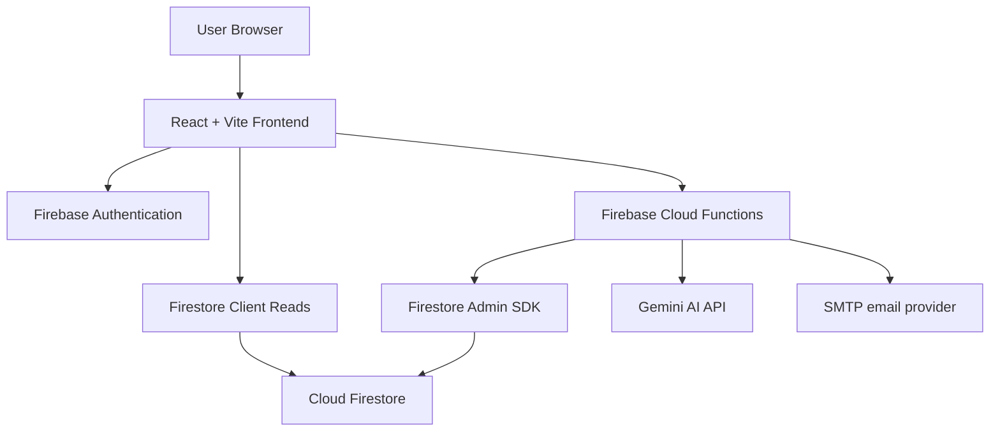
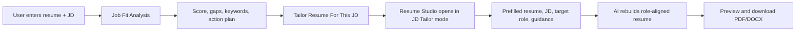

# AIVI Career Intelligence OS - Project Handoff Guide

Last updated: June 1, 2026

## 1. Executive Summary

AIVI Career Intelligence OS is a web-based AI career platform that helps users understand, improve, and act on their career readiness. The product combines resume analysis, resume rebuilding, job-fit scoring, skill-roadmap generation, interview preparation, promotion-readiness analysis, portfolio review, LinkedIn analysis, and admin-level usage monitoring.

The core product promise is:

> Build the right resume for the right job, understand the gaps, and move from career uncertainty to role-ready action.

The project is built as a React + Vite frontend with Firebase Authentication, Cloud Firestore, Firebase Cloud Functions, Firebase Hosting support, and Gemini AI integration through server-side functions.

## 2. Problem This Project Solves

Job seekers often struggle with disconnected career tools:

- Resume builders rewrite resumes but do not explain job fit.
- Job-fit tools score alignment but do not help users rebuild the resume immediately.
- Interview-preparation tools are usually isolated from the resume and target role.
- Freshers often do not have enough resume content to begin.
- Professionals do not know which career gaps are urgent and which are noise.

AIVI solves this by connecting career diagnostics and action in one system:

- Analyze a resume.
- Compare it against a job description.
- Identify missing skills, keywords, and experience gaps.
- Rebuild or tailor the resume from the same job-fit context.
- Generate a learning roadmap.
- Prepare for interviews.
- Track progress and previous analysis history.

## 3. Current Product Positioning

AIVI should be understood as a Career Intelligence OS, not only a resume builder.

Primary positioning:

- AI resume intelligence and rebuilding.
- JD-based job fit analysis.
- One-click movement from job-fit result to Resume Studio.
- Guided career improvement across resume, skills, interviews, portfolio, promotion readiness, and LinkedIn.

Primary audience:

- Freshers and college graduates creating their first resume.
- Active job seekers applying to specific job descriptions.
- Working professionals seeking better roles.
- Career switchers trying to understand skill gaps.
- Mid-level professionals targeting promotion or role advancement.

## 4. Technology Stack

### Frontend

- React 18
- TypeScript
- Vite
- React Router DOM
- Tailwind CSS
- shadcn/ui style component architecture
- Radix UI primitives
- Lucide React icons
- Framer Motion
- Recharts
- Sonner and shadcn toast systems
- jsPDF for PDF resume export
- docx for Word resume export

### Backend and Cloud

- Firebase Authentication
- Cloud Firestore
- Firebase Cloud Functions
- Firebase Admin SDK
- Firebase Hosting configuration
- Firebase emulator configuration for local backend testing

### AI Provider

- Google Gemini
- Model currently configured in Cloud Functions:

```text
gemini-2.5-flash
```

The functions use the Gemini API through the OpenAI-compatible endpoint for most structured JSON analysis calls, and the Google Generative AI SDK for PDF text extraction.

### Email

- Nodemailer
- Configured SMTP provider for contact form notification

### Deployment Target

- **Production Static Web Hosting**: Hostinger (`https://www.aivilabs.com/`) serves the compiled React SPA and leverages [.htaccess](file:///c:/Users/abhis/OneDrive/Documents/GitHub/aivi-career/public/.htaccess) for routing, CSP configurations, and verification action link redirects.
- **Staging, Rules & Functions**: Firebase Hosting, Cloud Functions, Firestore rules, and indexes are deployed directly to the Firebase project (`aivi-career`). Firebase Hosting handles staging testing and hosts the native authentication action route (`/__/auth/action`) to process verification emails.

## 5. Repository Structure

```text
aivi-career/
  docs/
    Product, architecture, roadmap, brand, and handoff documentation

  functions/
    Firebase Cloud Functions backend

  public/
    Static assets, brand logos, favicon, robots, sitemap, and SPA fallback assets

  src/
    Frontend React application

  src/components/
    Shared UI, headers, footers, dashboard shell, forms, history cards

  src/contexts/
    React context providers, including authentication state

  src/integrations/firebase/
    Firebase client initialization

  src/pages/
    Public pages, auth pages, dashboard pages, and product modules

  src/services/
    Frontend service wrappers for Cloud Functions and Firestore reads

  src/utils/
    Utility functions including scoring, exports, sanitization, and helpers

  firebase.json
    Firebase hosting, Firestore, functions, and emulator configuration

  firestore.rules
    Firestore security rules

  firestore.indexes.json
    Firestore composite indexes

  package.json
    Frontend scripts and dependencies
```

## 6. Main Application Routes

### Public Website

| Route | Purpose |
|---|---|
| `/` | Main landing page |
| `/about` | Company and product overview |
| `/how-it-works` | Workflow explanation |
| `/what-is-aivi` | AIVI explanation page |
| `/ai-resume-builder` | Public resume builder product page |
| `/linkedin-optimization` | Public LinkedIn optimization page |
| `/contact` | Contact form |
| `/privacy` | Privacy policy |
| `/terms` | Terms of service |

### SEO and Tool Pages

| Route | Purpose |
|---|---|
| `/ai-resume-builder-for-freshers` | Fresher resume builder landing page |
| `/resume-scoring-software` | Resume scoring page |
| `/job-fit-analysis-tool` | Job fit tool landing page |
| `/career-gap-analysis-ai` | Career gap and skill roadmap page |
| `/ai-vs-chatgpt-vs-gemini` | Comparison page |

### Authentication

| Route | Purpose |
|---|---|
| `/auth` | Login and signup |
| `/login` | Alias for auth |
| `/verify-email` | Email verification screen |

### Protected Dashboard

All routes below are protected by Firebase Authentication.

| Route | Purpose |
|---|---|
| `/dashboard` | Career command center |
| `/dashboard/resume` | Resume Intelligence |
| `/dashboard/builder` | Resume Studio |
| `/dashboard/job-fit` | Job Fit Analysis |
| `/dashboard/roadmap` | Skill Roadmap |
| `/dashboard/interview` | Interview Prep |
| `/dashboard/promotion` | Promotion Readiness |
| `/dashboard/portfolio` | Portfolio Analyzer |
| `/dashboard/linkedin` | LinkedIn Analyzer |
| `/dashboard/settings` | User settings |
| `/dashboard/admin` | Admin dashboard |

## 7. Product Modules

### 7.1 Dashboard Home

Purpose:

- Gives users a command-center view of their career progress.
- Shows plan status.
- Displays latest analyzer history.
- Highlights next recommended actions.
- Routes users into Resume Studio, Job Fit Analysis, and other modules.

Primary data source:

- `analysis_results`
- `user_plans`
- Firebase Auth user profile

### 7.2 Resume Intelligence

Purpose:

- Evaluates a resume for ATS compatibility, keyword quality, quantified impact, technical depth, leadership signal, and clarity.
- Shows missing sections, weak bullets, buzzwords, top skills, and improvement guidance.

Backend analysis type:

```text
resume
```

### 7.3 Resume Studio

Purpose:

- Rebuilds or tailors resumes using AI.
- Supports multiple user starting points.

Current Phase 1 paths:

- Full Rebuild
- Quick Edit
- JD Tailor
- First Resume

Current capabilities:

- Paste or upload resume.
- Enter target role.
- Add a job description for tailoring.
- Provide user guidance such as "rewrite only experience" or "make it concise".
- Select AI control mode.
- Select optimization targets.
- Choose tone and length preferences.
- Provide structured fresher inputs.
- Generate a rebuilt resume through the existing backend pipeline.
- Preview the resume.
- Download as PDF.
- Download as DOCX.

Backend analysis type:

```text
resume_rebuild
```

Important connected flow:

- Job Fit Analysis can pass resume text, job description, target role, and improvement guidance directly into Resume Studio.

### 7.4 Job Fit Analysis

Purpose:

- Compares a resume against a job description.
- Calculates match score and alignment gaps.
- Shows missing skills, keyword alignment, score breakdown, radar chart, action plan, and estimated improvement impact.

Current Phase 1 enhancements:

- Analysis intent selector.
- Focus area chips.
- Optional review instructions.
- `Tailor Resume For This JD` bridge into Resume Studio.

Backend analysis type:

```text
job_fit
```

Client-side scoring:

- The AI returns structured data.
- The frontend computes deterministic scores using job-fit scoring utilities.
- Computed scores can be saved with the analysis result.

### 7.5 Skill Roadmap

Purpose:

- Converts missing skills or target-role gaps into a 30/60/90 day learning plan.
- Provides resources, exercises, project ideas, certifications, and interview questions.

Backend analysis type:

```text
roadmap
```

### 7.6 Interview Prep

Purpose:

- Generates interview question banks from resume and optional job description.
- Covers technical, behavioral, resume-defense, case-study, and weak-area questions.

Backend analysis type:

```text
interview
```

### 7.7 Promotion Readiness

Purpose:

- Evaluates whether a user is ready for promotion from a current role to a target role.
- Produces readiness score, timeline estimate, gap breakdown, action plan, and positioning strategy.

Backend analysis type:

```text
promotion
```

### 7.8 Portfolio Analyzer

Purpose:

- Reviews GitHub/project portfolio strength.
- Scores technical depth and hiring attractiveness.
- Gives project-level improvement suggestions.

Backend analysis type:

```text
portfolio
```

### 7.9 LinkedIn Analyzer

Purpose:

- Analyzes LinkedIn profile text for authority, recruiter visibility, keyword strength, brand clarity, and conversion potential.
- Can also generate optimized LinkedIn profile content for eligible users.

Backend functions:

```text
linkedinAnalyze
linkedinOptimize
```

### 7.10 Admin Dashboard

Purpose:

- Gives admins visibility into users, plans, analysis volume, contact messages, and AI usage.
- Allows admin-controlled user updates.

Admin-only callable:

```text
adminUpdateUser
```

## 8. System Architecture

### High-Level Architecture



### Runtime Flow

1. User opens the website.
2. Public routes load without authentication.
3. Protected dashboard routes pass through `ProtectedRoute`.
4. Firebase Auth state is stored using browser local persistence.
5. User submits an analysis request.
6. Frontend calls a Firebase Cloud Function through `httpsCallable`.
7. Cloud Function checks authentication, usage limits, rate limits, and duplicate content.
8. Cloud Function calls Gemini and requests strict JSON output.
9. Cloud Function stores the result in Firestore.
10. Frontend renders the result and analysis history.

## 9. Firebase Services Used

### Firebase Authentication

Used for:

- Email/password login.
- Email/password signup.
- Google sign-in.
- Password reset.
- Email verification.
- Protected route access.
- Authenticated callable function requests.

Important frontend files:

- `src/pages/Auth.tsx`
- `src/pages/VerifyEmail.tsx`
- `src/contexts/AuthContext.tsx`
- `src/components/ProtectedRoute.tsx`

### Cloud Firestore

Used for:

- User profiles.
- User plans and quotas.
- User roles.
- Analysis results.
- AI usage logs.
- Contact messages.
- Admin dashboard data.

Important files:

- `firestore.rules`
- `firestore.indexes.json`
- `src/services/analysisService.ts`
- `src/services/planService.ts`
- `functions/src/index.ts`

### Firebase Cloud Functions

Used for:

- AI analysis.
- Usage checks.
- Coupon application.
- PDF extraction.
- LinkedIn analysis and optimization.
- Contact form processing.
- Admin plan/role updates.
- Signup initialization.

Important file:

- `functions/src/index.ts`

### Firebase Hosting

Configured in:

- `firebase.json`

Hosting public directory:

```text
dist
```

SPA rewrite:

```json
{
  "source": "**",
  "destination": "/index.html"
}
```

## 10. Cloud Functions API Reference

All callable functions are Firebase HTTPS callable functions. Most require an authenticated Firebase user.

### onUserSignupComplete

Trigger:

```text
Firebase Auth user creation
```

Purpose:

- Initializes user profile, plan, and role data after signup.

### applyCoupon

Callable:

```text
applyCoupon
```

Purpose:

- Applies a coupon or beta access code to the current user.
- Updates user plan/trial fields server-side.

Expected input:

```json
{
  "code": "FIRST1000"
}
```

### checkUsage

Callable:

```text
checkUsage
```

Purpose:

- Checks and increments usage for an analysis type.
- Enforces plan limits.

Expected input:

```json
{
  "analysisType": "resume"
}
```

Common analysis types:

- `resume`
- `job_fit`
- `roadmap`
- `interview`
- `promotion`
- `portfolio`
- `resume_rebuild`
- `linkedin_analyze`
- `linkedin_optimize`

### getUserPlanInfo

Callable:

```text
getUserPlanInfo
```

Purpose:

- Returns current user's plan and quota usage.

### careerAnalysis

Callable:

```text
careerAnalysis
```

Purpose:

- Main AI analysis endpoint for most product modules.

Expected input shape:

```json
{
  "analysis_type": "job_fit",
  "resume_text": "Resume content",
  "job_description": "Job description",
  "current_role": "Current role",
  "target_role": "Target role",
  "missing_skills": ["Skill 1", "Skill 2"],
  "projects": []
}
```

Supported analysis types:

- `resume`
- `job_fit`
- `roadmap`
- `interview`
- `promotion`
- `portfolio`
- `resume_rebuild`

Behavior:

- Requires authentication.
- Checks rate limits.
- Checks plan usage.
- Uses content hashing for duplicate-result caching.
- Calls Gemini.
- Parses AI response as JSON.
- Stores result in `analysis_results`.
- Logs cost and token usage in `ai_usage_logs`.

### saveAnalysisResult

Callable:

```text
saveAnalysisResult
```

Purpose:

- Saves an analysis result with computed client-side scores.

### extractPdf

Callable:

```text
extractPdf
```

Purpose:

- Extracts text from uploaded PDF resumes using Gemini multimodal support.

Expected input:

```json
{
  "pdf_base64": "base64-encoded-pdf"
}
```

### adminUpdateUser

Callable:

```text
adminUpdateUser
```

Purpose:

- Admin-only function for updating a user's role, plan, or quota usage.

Expected input:

```json
{
  "targetUserId": "firebase-user-id",
  "role": "admin",
  "planType": "pro",
  "resetQuota": true
}
```

### linkedinAnalyze

Callable:

```text
linkedinAnalyze
```

Purpose:

- Analyzes LinkedIn profile text and returns score/gap data.

Expected input:

```json
{
  "profileText": "LinkedIn profile content"
}
```

### linkedinOptimize

Callable:

```text
linkedinOptimize
```

Purpose:

- Generates optimized LinkedIn profile content from a previous analysis.

Expected input:

```json
{
  "analysisId": "analysis-result-id",
  "targetRole": "Product Manager",
  "industry": "SaaS"
}
```

### submitContactForm

Callable:

```text
submitContactForm
```

Purpose:

- Saves contact form submissions into Firestore.
- Sends email notification through the configured SMTP provider when `SMTP_PASSWORD` is configured.

Expected input:

```json
{
  "name": "User Name",
  "email": "user@example.com",
  "subject": "Partnership inquiry",
  "message": "Message text"
}
```

## 11. External APIs and Services

### Gemini API

Used for:

- Resume analysis.
- Job fit analysis.
- Roadmap generation.
- Interview prep generation.
- Promotion readiness.
- Portfolio analysis.
- Resume rebuild.
- LinkedIn analysis.
- LinkedIn optimization.
- PDF text extraction.

Required secret:

```text
GEMINI_API_KEY
```

### SMTP Email

Used for:

- Contact form email notifications.

Configured sender:

```text
hello@aivilabs.com
```

Required backend environment variable:

```text
SMTP_PASSWORD
```

### Firebase Client SDK

Used on the frontend for:

- Authentication.
- Firestore reads.
- Calling Cloud Functions.

Required frontend variables:

```text
VITE_FIREBASE_API_KEY
VITE_FIREBASE_AUTH_DOMAIN
VITE_FIREBASE_PROJECT_ID
VITE_FIREBASE_STORAGE_BUCKET
VITE_FIREBASE_MESSAGING_SENDER_ID
VITE_FIREBASE_APP_ID
VITE_USE_FIREBASE_EMULATOR
```

## 12. Firestore Collections

### profiles

Stores user profile data.

Access:

- User can read/write own profile.
- Admin can read profiles.

### user_plans

Stores plan, trial, and quota counters.

Common fields:

- `plan_type`
- `monthly_analysis_used`
- `lifetime_resume_count`
- `lifetime_jobfit_count`
- `lifetime_roadmap_count`
- `lifetime_interview_count`
- `lifetime_promotion_count`
- `lifetime_portfolio_count`
- `lifetime_rebuild_count`
- `lifetime_linkedin_count`
- `lifetime_linkedin_opt_count`
- `trial`
- `trialExpiresAt`
- `trialUsed`

Access:

- User can read own plan.
- Cloud Functions write through Admin SDK.

### user_roles

Stores user role.

Common roles:

- `user`
- `admin`

Access:

- User can read own role.
- Admin can read/write roles.

### analysis_results

Stores AI analysis results.

Common fields:

- `userId`
- `analysisType`
- `result`
- `scores`
- `contentHash`
- `createdAt`
- `parentAnalysisId`

Access:

- User can read own results.
- Admin can read all.
- Cloud Functions write through Admin SDK.

### ai_usage_logs

Stores AI usage and cost records.

Common fields:

- `userId`
- `analysisType`
- `model`
- `tokensUsed`
- `promptTokens`
- `completionTokens`
- `estimatedCost`
- `cached`
- `createdAt`

### contact_messages

Stores contact form submissions.

Common fields:

- `name`
- `email`
- `subject`
- `message`
- `status`
- `createdAt`

Access:

- Admin can read.
- Cloud Function writes.

### ai_rate_limits

Used by backend rate limiting logic.

### system_stats

Reserved for admin/system metrics.

## 13. Plan and Usage Model

The application uses plan-based access control.

Plan types:

- `free`
- `starter`
- `pro`
- `admin`

Free plan limits are enforced by analysis type. Server-side enforcement happens inside Cloud Functions, and the frontend also performs early checks for better UX.

Important files:

- `src/services/planService.ts`
- `functions/src/index.ts`
- `src/components/PlanUsageBanner.tsx`
- `src/components/UpgradeModal.tsx`

Admin users bypass normal usage limits.

## 14. Security Model

Security is handled through:

- Firebase Auth for identity.
- Firestore rules for client access.
- Cloud Functions for trusted writes.
- Admin SDK for privileged backend operations.
- Role checks for admin-only actions.
- Rate limiting for AI calls.
- Usage limits by plan.
- Server-side ownership checks for analysis data.

Important rule principle:

> Client-side writes are intentionally restricted for sensitive collections. Analysis results, usage logs, contact messages, and plan updates are written through Cloud Functions.

## 15. Local Development Requirements

### Required Software

- Node.js 20 or compatible modern Node runtime.
- npm.
- Git.
- Firebase CLI if working with emulators or Firebase deployment.

Recommended:

- Node.js 20 for Cloud Functions compatibility.

### Install Frontend Dependencies

```bash
npm install
```

### Install Backend Function Dependencies

```bash
cd functions
npm install
cd ..
```

### Environment Variables

Create or verify `.env.local` in the project root.

Required frontend variables:

```text
VITE_FIREBASE_API_KEY=
VITE_FIREBASE_AUTH_DOMAIN=
VITE_FIREBASE_PROJECT_ID=
VITE_FIREBASE_STORAGE_BUCKET=
VITE_FIREBASE_MESSAGING_SENDER_ID=
VITE_FIREBASE_APP_ID=
VITE_USE_FIREBASE_EMULATOR=false
```

Do not commit real secret values to a public repository.

Backend secrets should be configured in Firebase/Cloud Functions environment:

```text
GEMINI_API_KEY
SMTP_PASSWORD
```

## 16. Running Locally

### Run Frontend Dev Server

```bash
npm run dev
```

Default local URL:

```text
http://localhost:5173/
```

If port `5173` is occupied, Vite may choose another port.

### Run Production Preview Locally

```bash
npm run build
npm run preview
```

Preview URL is shown in the terminal, commonly:

```text
http://localhost:4173/
```

### Run Firebase Emulators

The Firebase emulator config is present in `firebase.json`.

Emulator ports:

- Auth: `9099`
- Firestore: `8080`
- Functions: `5001`
- Hosting: `5000`
- Emulator UI: `4000`

Start emulators with Firebase CLI:

```bash
firebase emulators:start
```

When using emulators, set:

```text
VITE_USE_FIREBASE_EMULATOR=true
```

## 17. Build and Deployment

### Build Production Bundle

```bash
npm run build
```

Output directory:

```text
dist/
```

### Deploy to Firebase

The project is deployed in two parts: static React client files to Hostinger, and database configurations/functions to Firebase.

### Deployment Steps:

1. Compile the React frontend client:
```bash
npm run build
```
*(This builds all frontend static assets into the `/dist` directory, including copying `.htaccess` from `/public`).*

2. Run repository local verification:
```bash
npm run security:verify
npm --prefix functions run build
npm test
```

3. Deploy backend and staging rules/indexes/functions to Firebase:
```bash
firebase deploy
```

4. Deploy client static files to Hostinger (`https://www.aivilabs.com/`):
- Compress the compiled `/dist` directory into a `.zip` archive.
- Upload this archive to Hostinger (in your root directory, typically `public_html/`) and extract it.

5. Test direct route refreshes on production:
```text
https://aivilabs.com/
https://aivilabs.com/auth
https://aivilabs.com/dashboard
https://aivilabs.com/career-gap-analysis-ai
```

The [.htaccess](file:///c:/Users/abhis/OneDrive/Documents/GitHub/aivi-career/public/.htaccess) file is required on Hostinger's Apache server so React Router routes do not return a 404 on refresh, to enforce security headers (CSP), and to redirect email verification links (`/__/auth/action`) back to Firebase Hosting.

### Deploy to Firebase Hosting

Firebase Hosting is already configured in `firebase.json`.

Build first:

```bash
npm run build
```

Deploy hosting:

```bash
firebase deploy --only hosting
```

Deploy functions:

```bash
firebase deploy --only functions
```

Deploy Firestore rules and indexes:

```bash
firebase deploy --only firestore
```

Deploy everything:

```bash
firebase deploy
```

## 18. QA Checklist Before Going Live

### Public Pages

Check:

- Home page loads.
- Header menu opens correctly.
- Product and AI Tools dropdowns work.
- Pricing section displays Indian pricing correctly.
- Footer links work.
- Mobile menu works.
- Favicon appears.
- Direct route refresh works on Firebase Hosting.

Important URLs:

```text
/
/about
/how-it-works
/ai-resume-builder
/job-fit-analysis-tool
/career-gap-analysis-ai
/linkedin-optimization
/contact
/privacy
/terms
```

### Auth

Check:

- Email/password signup works.
- Email/password login works.
- Google login works.
- Forgot password email sends.
- Refreshing a dashboard page keeps the user logged in.
- Email verification screen works.

### Dashboard

Check:

- Sidebar works expanded and collapsed.
- Dashboard history displays real user analysis data.
- Plan banner loads current plan.
- Sign out works.
- Admin menu appears only for admin users.

### Resume Studio

Check:

- All four paths render:
  - Full Rebuild
  - Quick Edit
  - JD Tailor
  - First Resume
- Paste resume works.
- Upload/extract resume works.
- Target role works.
- JD field works.
- Guidance field works.
- Generate works.
- Preview renders.
- Download PDF works.
- Download DOCX works.

### Job Fit Analysis

Check:

- Resume + JD analysis works.
- Score and breakdown render.
- Action plan renders.
- `Tailor Resume For This JD` opens Resume Studio.
- Resume Studio receives prefilled resume, JD, target role, and guidance.

### Other Product Modules

Check:

- Resume Intelligence.
- LinkedIn Analyzer.
- Skill Roadmap.
- Interview Prep.
- Promotion Readiness.
- Portfolio Analyzer.
- Settings.
- Admin Dashboard.

### Contact Form

Check:

- Contact form validates required fields.
- Submission saves to Firestore `contact_messages`.
- Email notification sends if SMTP password is configured.

## 19. Current Design System

AIVI now uses a light, vibrant product system aligned with the latest landing page redesign.

Brand direction:

- Clean, modern career-product feel.
- Strong orange action color.
- Teal intelligence accents.
- Gold logo/brand accents.
- Light dashboard surfaces.
- Dark panels used only for contrast and focus.

Brand assets:

```text
public/brand/aivi-mark.svg
public/brand/aivi-logo-dark.svg
public/brand/aivi-logo-light.svg
public/brand/aivi-logo-horizontal.svg
public/brand/aivi-favicon.svg
public/brand/aivi-app-icon.svg
```

Brand guideline file:

```text
docs/18_AIVI_Brand_Guidelines.md
```

## 20. Important Frontend Files

### App and Routing

```text
src/App.tsx
src/main.tsx
```

### Auth

```text
src/pages/Auth.tsx
src/pages/VerifyEmail.tsx
src/contexts/AuthContext.tsx
src/components/ProtectedRoute.tsx
```

### Public Site

```text
src/pages/Landing.tsx
src/pages/LandingConceptB.tsx
src/components/GlobalHeader.tsx
src/components/GlobalFooter.tsx
src/components/PublicPageShell.tsx
```

### Dashboard Shell

```text
src/layouts/DashboardLayout.tsx
src/components/DashboardSidebar.tsx
src/pages/DashboardHome.tsx
```

### Core Product Pages

```text
src/pages/ResumeIntelligence.tsx
src/pages/ResumeBuilder.tsx
src/pages/JobFitAnalysis.tsx
src/pages/SkillRoadmap.tsx
src/pages/InterviewPrep.tsx
src/pages/PromotionReadiness.tsx
src/pages/PortfolioAnalyzer.tsx
src/pages/LinkedInAnalyzer.tsx
src/pages/SettingsPage.tsx
src/pages/AdminDashboard.tsx
```

### Services

```text
src/services/analysisService.ts
src/services/planService.ts
```

### Utilities

```text
src/utils/jobFitScoring.ts
src/utils/resumeExport.ts
src/utils/sanitize.ts
```

## 21. AI Prompt and Response Strategy

The backend asks Gemini to return strict JSON for each analysis module. This is important because the frontend renders structured sections and score panels from expected fields.

Prompt categories include:

- Resume Intelligence
- Job Fit Analysis
- Skill Roadmap
- Interview Prep
- Promotion Readiness
- Portfolio Analyzer
- Resume Rebuild
- LinkedIn Analyze
- LinkedIn Optimize

Main prompt location:

```text
functions/src/index.ts
```

Related documentation:

```text
docs/AI_PROMPT_STRUCTURE.md
```

## 22. Resume Studio and Job Fit Connected Flow

This is one of the most important product flows.



This flow is central to AIVI's product differentiation.

## 23. Known Technical Notes

### Bundle Size Warning

The production build currently passes but shows a bundle-size warning for the Resume Builder chunk.

Reason:

- Resume Studio includes PDF and DOCX export libraries.

Impact:

- Not a deployment blocker.
- Could be optimized later by lazy-loading export libraries only when users click download.

### Backend Platform

The repository is Firebase-only. Legacy non-Firebase backend folders and migration docs have been removed to avoid confusion.

Current backend:

```text
Firebase Auth + Firestore + Cloud Functions
```

### Service Account File

The repo must not contain `service-account.json`.

Important:

- Do not expose service account credentials publicly.
- Do not upload service account files into web hosting.
- Do not include service account files inside `dist`.

## 24. Recommended Future Improvements

### Product Enhancements

- Resume Studio Phase 2 with before/after diff.
- Section-by-section accept/reject resume edits.
- Saved resume versions.
- JD re-score after resume rebuild.
- Application tracker.
- Role benchmark engine.
- Mock interview simulation.

### Technical Enhancements

- Lazy-load PDF/DOCX export libraries.
- Add automated route smoke tests.
- Add mobile visual regression checks.
- Add stronger error observability for Cloud Functions.
- Add structured logging dashboard for AI costs.
- Keep architecture docs aligned to Firebase Auth, Firestore, Cloud Functions, and Firebase Hosting.

### Deployment Enhancements

- Add CI build verification.
- Add production/staging environment separation.
- Add automated Firebase deploy workflow.
- Add domain-level redirect checks for `www` and non-`www`.

## 25. Quick Start for a New Developer

1. Clone the repo.

```bash
git clone <repo-url>
cd aivi-career
```

2. Install dependencies.

```bash
npm install
cd functions
npm install
cd ..
```

3. Create `.env.local`.

```text
VITE_FIREBASE_API_KEY=
VITE_FIREBASE_AUTH_DOMAIN=
VITE_FIREBASE_PROJECT_ID=
VITE_FIREBASE_STORAGE_BUCKET=
VITE_FIREBASE_MESSAGING_SENDER_ID=
VITE_FIREBASE_APP_ID=
VITE_USE_FIREBASE_EMULATOR=false
```

4. Start local dev server.

```bash
npm run dev
```

5. Open:

```text
http://localhost:5173/
```

5. Confirm `/healthz` returns HTTP 200.

## 26. Final Product Summary

AIVI is a Firebase-backed AI career platform focused on resume quality, job-fit alignment, and career progression. The product's strongest differentiator is its connected loop:

> Analyze resume and JD, identify gaps, then rebuild a better resume from that same job context.

The current project includes:

- Redesigned public site.
- Redesigned authentication.
- Redesigned dashboard shell.
- Redesigned product modules.
- Resume Studio Phase 1 enhancements.
- Job Fit Analysis Phase 1 enhancements.
- Direct PDF and DOCX resume export.
- Firebase Auth, Firestore, and Cloud Functions integration.
- Gemini-backed AI analysis.
- Firebase Hosting production build support.

This document should be treated as the primary handoff guide for understanding, running, testing, and deploying the current AIVI project.

---
### 🌐 Live Production & Infrastructure Baseline (August 17, 2026)
* **B2C Platform (`aivilabs.com`)**: Resume Studio v2 (4 creation paths), Job Fit Analysis (0-100% match radar), Vernacular Voice AI (Hindi/Hinglish/English), Skill Gap Roadmap, Promotion Readiness, Portfolio Analyzer.
* **B2B Campus OS (`campus.aivilabs.com`)**: Institutional white-label portal, SAML/OIDC SSO, Bulk Student Directory CSV Import, Placement Drives Pipeline Manager, Verified Student Resume Vault & ZIP Exporter (`exportResumePackage`), NAAC Criterion 5.2.1 & NIRF Metric 3.a Accreditation Audit Generator (`generateAccreditationReport`).
* **Transactional Email Gateway**: Zoho Mail India (`smtppro.zoho.in`, Port 465 SSL, `hello@aivilabs.com`).
* **Payment Gateway**: Razorpay Live Mode (`rzp_live_TEYQVaN7SquSvs`), HMAC-SHA256 signature verified webhooks (`/webhooks/razorpay`).
* **Hosting & VPS**: Hostinger KVM 4 VPS (`187.127.134.92`, Port 22 SSH), Staging (`/var/www/staging-aivi-campus/html`) & Production (`/var/www/aivi-campus/html`).
* **Deployment Safety Protocol**: Rules D1-D6 banning automatic deploys. Production deploys require explicit prompt `"DEPLOY"`.
