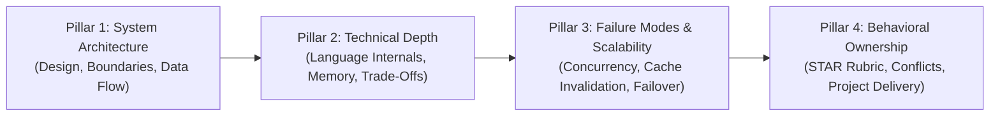
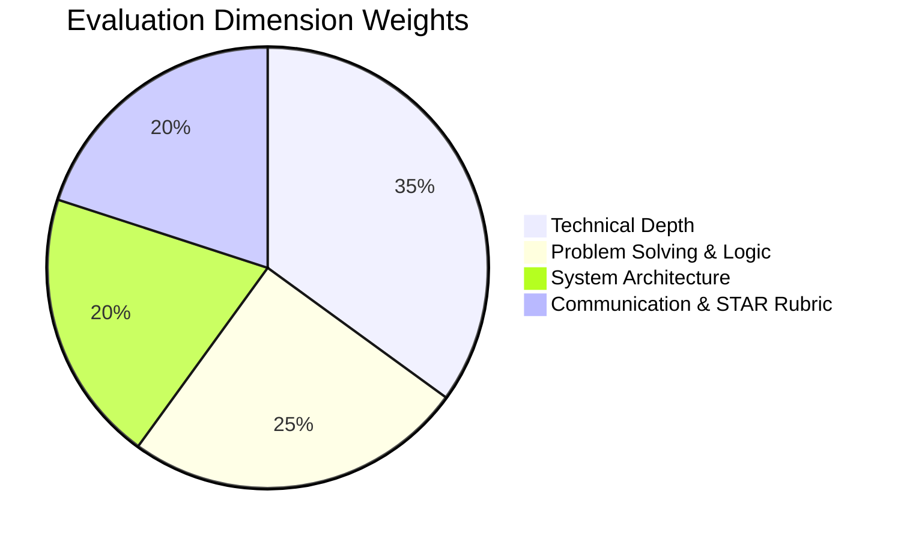

# 🏛️ AIVI CAMPUS OS & CAREER OS — MASTER AI INTERVIEW ENGINE
## 📐 Master Architectural Blueprint & Technical Specification (CTO Handover Edition)

---

### 📋 Document Metadata & Executive Brief
- **Entity**: AIVI INTELLIGENCE PRIVATE LIMITED *(CIN: `U62099UP2026PTC249169`)*
- **Product Lines**: AIVI Campus OS (B2B Multi-Tenant) & AIVI Career OS (B2C)
- **Target Audience**: Chief Technology Officer (CTO), Principal System Architects & Engineering Leads
- **Document Version**: `v3.0.0` (Production Master Specification)
- **Hosting / Data Residency**: Sovereign Google Cloud Platform — Mumbai Region (`asia-south1`)
- **Compliance Baseline**: Digital Personal Data Protection (DPDP) Act 2023

---

## 1. 🌐 Executive Topology & High-Level Architecture

The AIVI Interview Intelligence Engine is an **asynchronous and real-time full-duplex conversational AI system** engineered to conduct realistic technical, behavioral, and architectural interviews. It features Indic vernacular speech processing (Hindi, Hinglish, Indian English), low-latency turn-taking (<800ms), and automated forensic grading against Tier-1 enterprise rubrics.

```mermaid
flowchart TD
    subgraph Client ["Client Browser (Web Audio API & React)"]
        Mic["Microphone Input (16kHz / Mono)"] --> VAD["Smart Grammatical VAD & Silence Endpointing"]
        VAD --> Orb["VoiceFluidOrb (128 FFT / 3D Telemetry)"]
        SpeechRec["Continuous SpeechRecognition (hi-IN / en-IN)"] --> TurnBuffer["Candidate Utterance Buffer"]
    end

    subgraph Gateway ["Cloud Functions v2 (GCP Mumbai asia-south1)"]
        TurnBuffer --> |realtimeVoiceNextTurn| LLM["Gemini 2.5 Flash Brain (thinkingBudget: 0)"]
        LLM --> |Persona Prompt + 4 Pillars| NextQ["Next Question (12-18 words)"]
        NextQ --> Sarvam["Sarvam AI TTS (bulbul:v3 Indic Voice)"]
        Sarvam --> |Audio Buffer (Base64)| AudioOut["Client Audio Playback (Speaker)"]
    end

    subgraph Evaluation ["Post-Session Diagnostic Pipeline"]
        FullTranscript["Full Multi-Turn Transcript"] --> |evaluateRealtimeVoiceSession| GeminiEval["Gemini 2.5 Pro Evaluator"]
        GeminiEval --> Scorecard["Competencies + Telemetry + Senior Model Answers"]
        Scorecard --> AES["AIVI Employability Score (AES) Update"]
        AES --> TPO["TPO Command Center (Real-Time onSnapshot)"]
    end
```

---

## 2. 🔀 Dual-Pathway Architecture

The system supports two distinct interview modalities tailored to student readiness and target use cases:

| Dimension | Pathway A: Full-Duplex 2-Way Voice Studio | Pathway B: Structured Question Drill |
| :--- | :--- | :--- |
| **Primary Component** | [`src/components/interview-prep/RealtimeVoiceRoom.tsx`](file:///c:/Users/abhis/OneDrive/Documents/GitHub/aivi-campus-os/src/components/interview-prep/RealtimeVoiceRoom.tsx) | [`src/components/interview-prep/QuestionBankTab.tsx`](file:///c:/Users/abhis/OneDrive/Documents/GitHub/aivi-campus-os/src/components/interview-prep/QuestionBankTab.tsx) |
| **Backend Endpoints** | `startRealtimeVoiceSession` $\rightarrow$ `realtimeVoiceNextTurn` $\rightarrow$ `evaluateRealtimeVoiceSession` | `startMockInterview` $\rightarrow$ `answerMockInterviewTurn` $\rightarrow$ `finishMockInterview` |
| **Interaction Flow** | Continuous bidirectional verbal conversation with live turn-taking | Asynchronous, turn-by-turn question submission with immediate per-question review |
| **Speech Engine** | Client Web Speech + Sarvam AI partner TTS (`bulbul:v3`) | Base64 audio streaming with Sarvam/Bhashini ASR & TTS |
| **Target Use Case** | Final campus placements, off-campus drive rehearsals, live stress-testing | Topic-specific practice (e.g. SQL, System Design, DSA drills) |

---

## 3. 🎯 Pre-Interview Personalization & Persona Engine

Before any session starts, the engine ingests candidate and role context to eliminate generic interviews:

### 3.1 Three-Layer Context Ingestion
1. **Student Resume Context (`student_vault`):**  
   Candidate resume skills and project summaries are retrieved. **Question 1 is strictly programmed to cite a real project or skill** from the candidate's resume (e.g., *"I see on your resume that you built a Redis-backed caching system for E-Commerce. How did you handle cache invalidation?"*).
2. **Placement Drive Context (`placement_drives`):**  
   If launched through a college placement drive, company identity, role title, and JD requirements are automatically injected into the interviewer's prompt.
3. **Calibrated Indian Interview Personas:**  
   Synthesized via [`src/services/personaVoiceData.ts`](file:///c:/Users/abhis/OneDrive/Documents/GitHub/aivi-campus-os/src/services/personaVoiceData.ts) to match diverse corporate assessment styles:

```typescript
const PERSONA_PROMPTS = {
  ananya: "Technical Lead at IT Services enterprise (TCS/Accenture). Encouraging, professional. Probes core OOP, Java fundamentals, and structured STAR communication.",
  vikram: "Principal Engineer & Bar Raiser at top product firm (Amazon/Flipkart). Direct, assertive, rigorous. Probes system design trade-offs, concurrency, and algorithmic complexity.",
  priya: "Senior HR & People Partner at global consulting firm (Deloitte). Warm, observant. Probes behavioral conflicts, leadership under pressure, and ethical judgment.",
  kabir: "Senior Engineering Mentor speaking in bilingual Hinglish. Conversational, relatable. Helps the candidate open up while assessing technical clarity."
};
```

---

## 4. 🎙️ Client-Side Audio Engineering & Smart Grammatical VAD

Implemented in [`src/services/geminiLiveService.ts`](file:///c:/Users/abhis/OneDrive/Documents/GitHub/aivi-campus-os/src/services/geminiLiveService.ts) and [`RealtimeVoiceRoom.tsx`](file:///c:/Users/abhis/OneDrive/Documents/GitHub/aivi-campus-os/src/components/interview-prep/RealtimeVoiceRoom.tsx):

### 4.1 Audio Capture & Telemetry
- **Sample Rate**: 16,000 Hz, 1-channel mono, with browser echo cancellation, noise suppression, and auto-gain control.
- **Audio Analyser Node**: 128 FFT size, 0.8 smoothing time constant.
- **Orb Telemetry**: Decibel levels feed [`src/components/interview-prep/VoiceFluidOrb.tsx`](file:///c:/Users/abhis/OneDrive/Documents/GitHub/aivi-campus-os/src/components/interview-prep/VoiceFluidOrb.tsx), generating dynamic 3D fluid pulsations matching speaker volume.

### 4.2 Smart Grammatical Silence Endpointing (Candidate Never Cut Off)
Standard voice agents cut off candidates after 800ms of silence. AIVI utilizes a **grammatically aware silence endpointing model**:

```typescript
// 1. Minimum utterance threshold: ignores ambient noise or clicks
if (words.length >= 5) {
  const lastWord = words[words.length - 1].toLowerCase().replace(/[^a-z]/g, "");
  const hesitationWords = new Set([
    "and", "so", "but", "or", "because", "like", "actually", "basically",
    "um", "uh", "matlab", "then", "if", "when", "also", "with", "to", "for"
  ]);
  const endsWithPunctuation = /[.!?]$/.test(trimmed);
  const isHesitating = hesitationWords.has(lastWord);

  // 2. Calibrated dynamic silence window
  let silenceWaitMs = 3500; // Baseline: 3.5 seconds
  if (endsWithPunctuation && words.length >= 15 && !isHesitating) {
    silenceWaitMs = 2800;   // Completed long thought: 2.8s fast endpointing
  } else if (isHesitating || words.length < 10) {
    silenceWaitMs = 4500;   // Hesitation pause or developing introduction: 4.5s breathing space
  }

  candidateSilenceTimer = setTimeout(() => {
    handleAutoSubmitTurn();
  }, silenceWaitMs);
}
```

### 4.3 Inactivity Watchdog
- **45 seconds of candidate silence**: AI interviewer speaks a verbal nudge (*"I haven't heard from you in a moment. Take your time, or let me know when you're ready to proceed."*).
- **90 seconds of candidate silence**: Gracefully closes session and saves partial telemetry.

---

## 5. 🧠 Turn-Taking Brain & The 4 Core Interview Pillars

Every interview session dynamically moves across **4 Architectural Pillars**:



### 5.1 Latency Optimization & Generation Rules
- **`thinkingBudget: 0`**: Explicitly disables Gemini internal reasoning tokens, saving **300–500ms** of latency.
- **12–18 Spoken Words Maximum**: The interviewer asks crisp, single-sentence questions (e.g., *"Got it. How did you ensure thread safety when multiple users updated inventory concurrently?"*).
- **Conversational Intent Handling**:
  - *Candidate requests clarification / repeat*: Rephrases question in simpler terms without score penalty.
  - *Candidate requests Hindi ("Kya aap Hindi me bol sakte ho?")*: Immediately switches response and TTS to conversational Hindi/Hinglish.
  - *Candidate gives vague answer*: AI interviewer asks a targeted micro-probe challenging them to specify frameworks, metrics, or database schemas.

---

## 6. 📊 Acoustic Delivery Metrics (Yoodli-Grade Telemetry)

For every candidate turn, [`computeDeliveryMetrics`](file:///c:/Users/abhis/OneDrive/Documents/GitHub/aivi-campus-os/functions/src/index.ts#L6918) calculates forensic speech pacing:

### 6.1 Words Per Minute ($WPM$)
$$\text{WPM} = \text{clamp}\left(70, \, 200, \, \text{round}\left(\frac{\text{Word Count}}{\text{Duration (sec)}} \times 60\right)\right)$$
- **Optimal Band**: **110 – 160 WPM** (Professional tech interview pacing)
- **Rushed Band**: $>160 \text{ WPM}$ (Risk of low clarity under pressure)
- **Deliberate / Hesitant Band**: $<110 \text{ WPM}$ (Risk of weak articulation)

### 6.2 Filler Word Frequency & Density ($F_{\text{density}}$)
Tracks English and Indic filler words using regex:
$$\text{Regex: } \backslash\text{b}(\text{um}|\text{uh}|\text{hmm}|\text{like}|\text{you know}|\text{matlab}|\text{yaani}|\text{basically}|\text{actually})\backslash\text{b}$$

---

## 7. 📑 Post-Interview Diagnostic Reasoning & Rubric Evaluation

When the interview ends, [`evaluateRealtimeVoiceSession`](file:///c:/Users/abhis/OneDrive/Documents/GitHub/aivi-campus-os/functions/src/index.ts#L7658) triggers deep evaluation via Gemini:

### 7.1 Anti-Gaming Abort Guard
If candidate responses total **$<15$ words**, the session is marked `status: "incomplete"` with a score of `0/100`, preventing gaming through empty sessions.

### 7.2 4 Core Competency Dimensions (0–100 Scale)



1. **Technical Depth (35%)**: Correctness, terminology, architectural awareness, edge-case handling.
2. **Problem Solving (25%)**: Algorithmic reasoning, trade-off evaluation, debugging methodology.
3. **System Architecture (20%)**: Modular separation, caching, database schema, scaling principles.
4. **Communication & STAR Rubric (20%)**:
   - **S**ituation (Business Context)
   - **T**ask (Candidate Responsibility)
   - **A**ction (Engineering Execution)
   - **R**esult (Measurable ROI / Impact: latency drops, throughput gains)

### 7.3 Question-by-Question Dossier
Every question asked includes:
- Score out of 10.
- Key strengths demonstrated.
- Gaps identified.
- **Senior Staff Engineer Model Answer**: A concrete 3–5 sentence gold-standard response demonstrating exact terminology, tools, and STAR structure.

### 7.4 Actionable 7-Day Targeted Study Plan
Synthesizes a day-by-day remediation curriculum targeting the exact gaps exposed during the interview.

---

## 8. 📈 AES Integration & Real-Time TPO Telemetry

### 8.1 Composite AIVI Employability Score (AES) Formula
The completed interview updates the candidate's `employability_scores` document:
$$\text{AES} = (0.40 \times S_{\text{Resume}}) + (0.35 \times S_{\text{Skill}}) + (0.25 \times S_{\text{Interview}})$$
Where $S_{\text{Interview}} = \text{Overall Interview Score } (0\text{--}100)$.

### 8.2 Real-Time Command Center Synchronization
- `mock_interviews` documents are saved with student metadata (`fullName`, `enrollmentNo`, `branch`, `batch`, `company`, `score`, `telemetry`).
- Both [`CampusDashboard.tsx`](file:///c:/Users/abhis/OneDrive/Documents/GitHub/aivi-campus-os/src/pages/campus/CampusDashboard.tsx) and [`CampusInterviews.tsx`](file:///c:/Users/abhis/OneDrive/Documents/GitHub/aivi-campus-os/src/pages/campus/CampusInterviews.tsx) listen via Firestore `onSnapshot`.
- **Result**: As soon as a student completes an interview on their phone or laptop, the TPO's Command Center KPI (*"Mocks Completed"*) and live candidate logs update **instantly without requiring a page refresh**.

### 8.3 Faculty Review & Score Adjustment
TPO Directors have institutional oversight through `adjustFacultyInterviewScore`:
- Review the verbatim audio transcript.
- Override or calibrate the AI score with a mandatory faculty note.
- Maintains a permanent statutory audit log.

---

## 9. 🛡️ Statutory Data Sovereignty (DPDP Act 2023 Compliance)

1. **Zero Raw Audio Retention**: Candidate microphone audio is processed **100% in-memory**. Raw audio buffers are passed to Sarvam/Bhashini ASR and **discarded immediately**. Audio recordings are **never saved to cloud disks or storage buckets**.
2. **Text-Only Persistence**: Only the text transcript and mathematical telemetry metrics are persisted in Firestore.
3. **100% Domestic Hosting**: All Cloud Functions and database nodes reside domestically in **Google Cloud Mumbai (`asia-south1`)**, satisfying DPDP Act 2023 data localization mandates.

---

## 10. 🗂️ Code Inventory & File Reference Matrix

| Subsystem | File Path | Key Functions / Symbols |
| :--- | :--- | :--- |
| **Live Audio Room** | [`src/components/interview-prep/RealtimeVoiceRoom.tsx`](file:///c:/Users/abhis/OneDrive/Documents/GitHub/aivi-campus-os/src/components/interview-prep/RealtimeVoiceRoom.tsx) | `RealtimeVoiceRoom`, `handleAutoSubmitTurn` |
| **Voice Orb Visualizer** | [`src/components/interview-prep/VoiceFluidOrb.tsx`](file:///c:/Users/abhis/OneDrive/Documents/GitHub/aivi-campus-os/src/components/interview-prep/VoiceFluidOrb.tsx) | `VoiceFluidOrb` |
| **Audio Client & VAD** | [`src/services/geminiLiveService.ts`](file:///c:/Users/abhis/OneDrive/Documents/GitHub/aivi-campus-os/src/services/geminiLiveService.ts) | `GeminiLiveVoiceSession`, `AudioContext (16kHz)` |
| **Persona Voice Config** | [`src/services/personaVoiceData.ts`](file:///c:/Users/abhis/OneDrive/Documents/GitHub/aivi-campus-os/src/services/personaVoiceData.ts) | `PERSONA_VOICES`, `PERSONA_PROMPTS` |
| **Forensic Scorecard** | [`src/components/interview-prep/InterviewIntelligenceReport.tsx`](file:///c:/Users/abhis/OneDrive/Documents/GitHub/aivi-campus-os/src/components/interview-prep/InterviewIntelligenceReport.tsx) | `InterviewIntelligenceReport`, `handleDownloadPdf` |
| **TPO Interview Console** | [`src/pages/campus/CampusInterviews.tsx`](file:///c:/Users/abhis/OneDrive/Documents/GitHub/aivi-campus-os/src/pages/campus/CampusInterviews.tsx) | `CampusInterviews`, real-time `onSnapshot` |
| **Cloud Functions (Brain)** | [`functions/src/index.ts`](file:///c:/Users/abhis/OneDrive/Documents/GitHub/aivi-campus-os/functions/src/index.ts) | `startMockInterview` (L6623), `answerMockInterviewTurn` (L6850), `startRealtimeVoiceSession` (L7388), `realtimeVoiceNextTurn` (L7484), `evaluateRealtimeVoiceSession` (L7658), `synthesizePersonaVoice` (L7279) |

---
*Authored for Executive Review · AIVI Intelligence Private Limited · Confidential & Proprietary*
