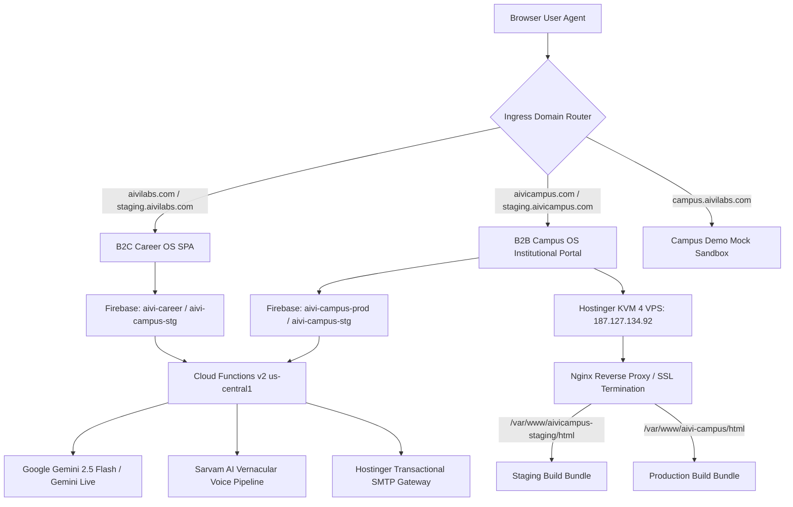

# AIVI Career & Campus OS — Master Technical & Architecture Documentation
> **Version**: 2.5.0 (Master CTO Technical Handover Edition)  
> **Effective Date**: October 1, 2026  
> **Authoritative Entity**: AIVI INTELLIGENCE PRIVATE LIMITED  
> **Corporate Identity**: CIN `U62099UP2026PTC249169` | PAN `ABFCA9830M` | TAN `ALDA10325A`  
> **Statutory Accreditations**: DPIIT Recognition `#DIPP271794` | MSME Udyam `UDYAM-UP-32-0123988`  
> **Registered Headquarters**: Gorakhpur - 273010, Uttar Pradesh, India (Purvanchal Domicile)  
> **Executive Leadership**: Abhishek Mishra (Founder & CEO), Anjali Tiwari (Co-Founder & Director), Rishikesh Raj (COO)  
> **Infrastructure Target**: GCP Mumbai (`asia-south1`) & US Central (`us-central1`) | Hostinger KVM 4 VPS (`187.127.134.92`)  
> **Compliance Standard**: Digital Personal Data Protection (DPDP) Act 2023 | Sovereign AI In-Memory Processing  

---

## 📌 Executive Table of Contents
1. [Executive Summary & Multi-Platform Topology](#1-executive-summary--multi-platform-topology)
2. [Ecosystem Boundaries & Domain Targets](#2-ecosystem-boundaries--domain-targets)
3. [Core Technology Stack & Version Registry](#3-core-technology-stack--version-registry)
4. [Frontend Application Architecture & Route Registry](#4-frontend-application-architecture--route-registry)
5. [Backend Architecture & Cloud Functions v2 Registry](#5-backend-architecture--cloud-functions-v2-registry)
6. [AI Engine Architecture (Gemini 2.5 Flash, Gemini Live & Sarvam AI)](#6-ai-engine-architecture)
7. [Full-Duplex 2-Way Real-Time Voice Studio (Web Audio 16kHz)](#7-full-duplex-2-way-real-time-voice-studio)
8. [Sliding-Window Rate Limiting & Abuse Protection](#8-sliding-window-rate-limiting--abuse-protection)
9. [Firestore Database Schema & State Machines](#9-firestore-database-schema--state-machines)
10. [Security Rules & Multi-Tenant Boundary Isolation](#10-security-rules--multi-tenant-boundary-isolation)
11. [Decoupled Placement Status & Sprints Architecture](#11-decoupled-placement-status--sprints-architecture)
12. [Institutional Resume Vault, Digital Watermarking & QR Proof Minting](#12-institutional-resume-vault-watermarking--qr-minting)
13. [Corporate Placement Drives & Shortlisting Funnels](#13-corporate-placement-drives--shortlisting-funnels)
14. [NAAC Metric 5.2.1 & NIRF Accreditation Audit Pack Engine](#14-naac-metric-521--nirf-accreditation-audit-pack-engine)
15. [Staging vs Production Build Mode & Nginx Reverse Proxy Architecture](#15-staging-vs-production-build-mode--nginx-reverse-proxy)
16. [Complete Bug History, Forensic Resolutions & Stabilization Ledger](#16-complete-bug-history-forensic-resolutions--stabilization-ledger)
17. [8-Engineer Master QA Testing Protocol & 100-Test-Case Suite](#17-8-engineer-master-qa-testing-protocol--100-test-case-suite)
18. [Disaster Recovery, Rollback Playbooks & Incident SOP](#18-disaster-recovery-rollback-playbooks--incident-sop)

---

## 1. Executive Summary & Multi-Platform Topology

**AIVI** (Artificial Intelligence Visibility & Employability Insights) is India's sovereign, dual-engine AI platform engineered to transform employability intelligence:
1. **AIVI Career OS (B2C)**: Flagship career acceleration for job seekers, working professionals, and freshers (`https://aivilabs.com`).
2. **AIVI Campus OS (B2B)**: Institutional employability intelligence and training & placement operating system for universities, colleges, and placement cells (`https://aivicampus.com`).
3. **AIVI Campus Demo**: Backend-free static demonstration SPA for client demonstrations (`https://campus.aivilabs.com`).



---

## 2. Ecosystem Boundaries & Domain Targets

Strict physical, operational, and database isolation is enforced between the B2C consumer application and the B2B enterprise platform:

| Platform | Repository | Live URLs | Firebase Project | Target Audience | Primary Focus |
| :--- | :--- | :--- | :--- | :--- | :--- |
| **AIVI Career OS (B2C)** | `aivi-career` | **Prod**: `https://aivilabs.com`<br>**Stg**: `https://staging.aivilabs.com` | **Prod**: `aivi-career`<br>**Stg**: `aivi-campus-stg` | Individual job seekers, students, career switchers | Resume builder, ATS analyzer, LinkedIn optimizer, Job-fit matcher, 2-way AI voice prep |
| **AIVI Campus OS (B2B)** | `aivi-campus-os` | **Prod**: `https://aivicampus.com`<br>**Stg**: `https://staging.aivicampus.com` | **Prod**: `aivi-campus-prod`<br>**Stg**: `aivi-campus-stg` | Universities, TPO Directors, Faculty Coordinators | Cohort telemetry, Resume Vault, QR minting, Placement Drives, Sprints, NAAC C5.2.1 |
| **AIVI Campus Demo** | `aivi-campus-demo` | **Prod**: `https://campus.aivilabs.com` | Static In-Memory Mock SPA | Public prospective clients & sales demos | Backend-free demonstration sandbox |

> [!CAUTION]
> **CAMPUS OS IS A PROTECTED ENTERPRISE ZONE**:  
> No B2C feature or script may touch `aivi-campus-prod` or `aivicampus.com` without multi-tenant validation. Any shared features must maintain separate Firestore collection boundaries.

---

## 3. Core Technology Stack & Version Registry

### 3.1. Frontend Core
- **Framework**: React 18.3.1
- **Language**: TypeScript 5.5+ (Strict Type Checking)
- **Build Engine**: Vite 5.4.1 (ESBuild dev server, Rollup production bundler)
- **Styling**: Tailwind CSS 3.4.1 + Radix UI Primitives (`@radix-ui/*`) + Lucide React icons
- **State & Remote Data**: React 18 Context (`AuthContext`, `TenantBrandingContext`) + `@tanstack/react-query`
- **Routing**: `react-router-dom` v6.26.1 (Protected routing with `<ProtectedRoute>` and role guards)
- **Audio & Visualizer**: Web Audio API (16kHz AudioContext, AnalyserNode) + Canvas 2D/3D dynamic rendering

### 3.2. Backend & Cloud Infrastructure
- **Runtime**: Node.js 20 (Serverless Cloud Functions v2)
- **Backend Framework**: `firebase-functions/v2` (`https.onCall`) + `firebase-admin` v12.0+
- **Database**: Cloud Firestore (NoSQL Document Store, Multi-Region / GCP Mumbai `asia-south1`)
- **Storage**: Firebase Cloud Storage (GCP Bucket storage for resumes and artifacts)
- **Authentication**: Firebase Authentication (Email/Password, Google OAuth 2.0, Session JWTs)
- **AI Models**:
  - `gemini-2.5-flash`: Multimodal PDF extraction and core career diagnostics.
  - `gemini-2.0-flash` / Gemini Live: Full-duplex real-time audio analysis.
  - Sarvam AI: Vernacular Hindi & Hinglish Speech-to-Text and Text-to-Speech.
- **Reverse Proxy & Edge**: Hostinger KVM 4 VPS (`187.127.134.92`), Nginx 1.24+, Let's Encrypt SSL/TLS v1.3.

---

## 4. Frontend Application Architecture & Route Registry

### 4.1. B2C Career OS Route Tree (`src/App.tsx`)
```
/                                   -> LandingPage (Hero, Pillars, Pricing, Testimonials)
/auth, /login                       -> Auth (Email/Password & Google OAuth)
/verify-email                       -> Email verification pending screen
/about, /how-it-works, /contact     -> Corporate information & statutory disclosures
/dashboard                          -> Command Center (Score rings, plan badge, quick action grid)
/dashboard/resume                   -> Resume Intelligence (6 ATS sub-scores, weak bullets, PDF parse)
/dashboard/job-fit                  -> Job Fit Matcher (Resume vs JD, missing skill taxonomy, 1-click bridge)
/dashboard/roadmap                  -> Skill Roadmap (4-week milestone curriculum with resources & projects)
/dashboard/interview                -> Interview Prep (2-Way Voice Studio & Question Drill)
/dashboard/promotion                -> Promotion Readiness (Level gap assessment & ownership benchmarks)
/dashboard/portfolio                -> Portfolio Analyzer (System design complexity & GitHub audit)
/dashboard/linkedin                 -> LinkedIn Analyzer (Authority scoring & Starter-gated optimizer)
/dashboard/builder                  -> Resume Studio (ATS single-column live preview, experience editor, PDF export)
/dashboard/settings                 -> Profile settings, plan details, coupon code redemption
/dashboard/admin                    -> Admin Portal (Guarded by isAdmin: user search, quota reset, cost telemetry)
```

### 4.2. B2B Campus OS Route Tree (`src/App.tsx`)
```
/                                   -> ForCollegesPage (Institutional Hero, NAAC, Sprints, Pricing)
/campus/login                       -> BrandedLogin Gateway (Find College Portal via slug / code)
/campus/login/:tenantCode           -> BrandedLogin 3-Pill Selector (Student, TPO/Admin, Faculty)
/campus                             -> CampusDashboard (Command Center, Funnels, Branch AES Heatmaps)
/campus/students                    -> StudentsDirectory (Student Roster, Placement Status, Filter by Branch)
/campus/students/import             -> StudentImportWizard (Bulk CSV roster validation & ingestion)
/campus/vault                       -> ResumeVault (Review Queue, Digital Watermarking, QR Proof Minting)
/campus/drives                      -> PlacementDrives (Corporate Drives, Eligibility Filtering, Funnels)
/campus/sprints                     -> PlacementSprints (Option A Sprints, Company Prep Modules)
/campus/interviews                  -> CampusInterviews (AI Mock Interview Lab Telemetry & Scoring Dossiers)
/campus/accreditation               -> AccreditationReports (NAAC Metric 5.2.1 & NIRF SSR Data Pack Generator)
/campus/settings                    -> Institutional tenant settings, branding, coordinator management
/platform-admin                     -> PlatformAdminConsole (Master Super Admin: Tenant provisioning, token limits)
```

---

## 5. Backend Architecture & Cloud Functions v2 Registry

All cloud functions are implemented in `functions/src/index.ts` as HTTPS Callable functions (v2) with strict typing, input sanitization, and quota verification:

| Function Name | Ingress Type | Auth Guard | Quota & Rate Limit | Description & Model |
| :--- | :--- | :--- | :--- | :--- |
| `careerAnalysis` | HTTPS Callable v2 | Required (`request.auth`) | Deducts from `monthly_usage` / plan limits | Powers Resume, Job Fit, Roadmap, Promotion, Portfolio, and Interview evaluations via `gemini-2.5-flash`. Returns strict structural JSON. |
| `extractPdf` | HTTPS Callable v2 | Required (`request.auth`) | Free utility | Multimodal PDF extractor using Gemini 2.5 Flash base64 vision parsing. Circumvents legacy PDF.js failures on scanned files and complex multi-column resumes. |
| `linkedinAnalyze` | HTTPS Callable v2 | Required (`request.auth`) | **Sliding Window: 3 req/min** | Ingests profile text and outputs Recruiter Appeal Score (0-100), headline critique, and section breakdowns. |
| `linkedinOptimize` | HTTPS Callable v2 | Required (`request.auth`) | Plan-Gated (Starter / Pro) | Heavy generative rewrite of LinkedIn Headline, About, and Experience sections based on target role. |
| `checkUsage` | HTTPS Callable v2 | Required (`request.auth`) | Read-only | Returns active user quota status across all lifetime and monthly features. |
| `getUserPlanInfo` | HTTPS Callable v2 | Required (`request.auth`) | Read-only | Retrieves plan tier, expiry date, active trial flag, and feature flags. |
| `applyCoupon` | HTTPS Callable v2 | Required (`request.auth`) | Atomic Transaction | Redeems promo coupons (e.g. `FIRST1000`). Increments atomic counter in `system_stats/beta` and elevates user to Starter tier for 30 days. |
| `adminUpdateUser` | HTTPS Callable v2 | Admin Only (`user_roles`) | Restricted | Allows superadmins to modify user roles, reset usage quotas, and unblock expired trial accounts. |
| `submitContactForm` | HTTPS Callable v2 | Public + Honeypot | Buffer validation | Delivers inbound contact/demo requests via Hostinger SMTP gateway with anti-bot honeypot suppression. |
| `saveAnalysisResult`| HTTPS Callable v2 | Required (`request.auth`) | Internal persistence | Writes diagnostic scorecard results securely to Firestore `analysis_results`. |
| `onUserSignupComplete`| Auth Trigger v1 | Automatic (`user.onCreate`)| System trigger | Seeds initial `users`, `user_plans` (free baseline), and `user_roles` documents upon Firebase Auth registration. |

---

## 6. AI Engine Architecture

### 6.1. Multi-Model Pipeline
- **Gemini 2.5 Flash (`gemini-2.5-flash`)**: Primary workhorse. Chosen for high-throughput structural JSON generation, low latency (<2.5s), and superior multi-page multimodal document understanding.
- **Gemini 2.0 Flash / Gemini Live**: Powers low-latency conversational audio streaming for mock interviews (<500ms voice turnaround).
- **Sarvam AI**: Vernacular speech-to-text pipeline specialized in Indian regional languages (Hindi, Hinglish, Marathi, Tamil, Telugu).

### 6.2. System Prompt Engineering & Trust Boundaries
Implemented in `functions/src/security/aiGuards.ts`:
- **Strict JSON Enforcement**: Prompts mandate `Return ONLY a valid JSON object — no markdown, no explanation outside JSON.`
- **Prompt Injection Defense**: User content is wrapped in trust boundary markers:
  ```typescript
  export const AI_TRUST_BOUNDARY = {
    USER_INPUT_START: "=== BEGIN CANDIDATE UNTRUSTED INPUT ===",
    USER_INPUT_END: "=== END CANDIDATE UNTRUSTED INPUT ==="
  };
  ```
- **Resilient JSON Parser (`parseGeminiJson`)**: Strips markdown fences (````json ... ````), fixes trailing commas, unescaped quotes, and conversational preamble text before parsing.

---

## 7. Full-Duplex 2-Way Real-Time Voice Studio

The Voice Studio (`src/components/interview/RealtimeVoiceRoom.tsx` & `src/services/geminiLiveService.ts`) delivers a real-time conversational interview experience:

```
┌─────────────────────────────────────────────────────────────┐
│                    Web Audio Architecture                    │
│                                                             │
│   Microphone (User) ───> 16kHz AudioContext ───> AnalyserNode│
│                                                    │        │
│   3D Fluid Orb Visualizer (VoiceFluidOrb.tsx) <────┘        │
│                                                             │
│   Continuous SpeechRecognition (Instant Interruption)       │
│                                │                            │
│   Gemini Live / Sarvam AI Engine                            │
│                                │                            │
│   SpeechSynthesis (Persona Accent Matching: Priya, Vikram)  │
│                                                             │
│   Session Abort Guard (<5 Words Spoken ──> Abort Dossier)   │
│                                                             │
│   Interview Intelligence Scorecard (WPM, Fillers, Clarity)  │
└─────────────────────────────────────────────────────────────┘
```

### Telemetry & Acoustic Scoring Metrics:
1. **WPM Pace**: Words Per Minute calculated from continuous speech timestamps (Target: 130–155 WPM).
2. **Clarity Score (0–100%)**: Evaluates sentence cohesion and phonetic confidence.
3. **Filler Word Counter**: Flags occurrences of *"um"*, *"uh"*, *"like"*, *"basically"*, *"you know"*.
4. **STAR Alignment**: Analyzes whether answers structure Situation, Task, Action, and Result.

---

## 8. Sliding-Window Rate Limiting & Abuse Protection

To prevent API token exhaustion and automated scraping attacks, an in-memory sliding window rate limiter is enforced on high-cost endpoints:

```typescript
interface RateLimitRecord {
  timestamps: number[];
}
const rateLimitMap = new Map<string, RateLimitRecord>();

function checkSlidingWindowRateLimit(uid: string, limit = 3, windowMs = 60000): boolean {
  const now = Date.now();
  const record = rateLimitMap.get(uid) || { timestamps: [] };
  // Filter out timestamps older than windowMs
  record.timestamps = record.timestamps.filter(ts => now - ts < windowMs);
  
  if (record.timestamps.length >= limit) {
    return false; // Rate limit exceeded
  }
  
  record.timestamps.push(now);
  rateLimitMap.set(uid, record);
  return true;
}
```

- **Enforced On**: `linkedinAnalyze` (3 requests / 60 seconds per UID).
- **Failure Mode**: Returns `HttpsError("resource-exhausted", "Too many requests. Please wait a minute before analyzing again.")`.

---

## 9. Firestore Database Schema & State Machines

### 9.1. Core Collections
- **`users/{uid}`**: Identity records (`email`, `displayName`, `tenantId`, `createdAt`).
- **`user_plans/{uid}`**: Entitlement records (`plan_type`, `monthly_usage`, `trialUsed`, `betaExpiry`, lifetime counts).
- **`user_roles/{uid}`**: Privilege records (`role: "admin" | "staff" | "student"`).
- **`profiles/{uid}`**: Student academic dossiers (`branch`, `cgpa`, `backlogs`, `placementStatus`, `resumeVerified`, `dpdpConsent`).
- **`resume_vault/{resumeId}`**: Review queue records (`studentId`, `tenantId`, `status`, `qrToken`, `watermarkApplied`, `starScore`).
- **`placement_drives/{driveId}`**: Corporate hiring events (`tenantId`, `company`, `role`, `ctcLpa`, `criteria`, `status`).
- **`drive_applications/{appId}`**: Student drive applications (`driveId`, `studentId`, `status: "applied" | "shortlisted" | "offered"`).
- **`sprints/{sprintId}`** & **`placement_sprints/{sprintId}`**: Company preparation bootcamps (`tenantId`, `company`, `rounds`, `activeStudents`).
- **`accreditation_exports/{exportId}`**: Generated NAAC/NIRF SSR data packs (`academicYear`, `pdfUrl`, `csvUrl`, `metrics`).
- **`system_stats/beta`**: Singleton atomic counter for the `FIRST1000` campaign.

---

## 10. Security Rules & Multi-Tenant Boundary Isolation

The production `firestore.rules` enforces multi-tenant boundary checks and role-based permissions:

```javascript
rules_version = '2';
service cloud.firestore {
  match /databases/{database}/documents {
    
    // Helper functions
    function isAuthenticated() {
      return request.auth != null;
    }
    function isOwner(userId) {
      return isAuthenticated() && request.auth.uid == userId;
    }
    function isStaff() {
      return isAuthenticated() && 
        exists(/databases/$(database)/documents/user_roles/$(request.auth.uid)) &&
        get(/databases/$(database)/documents/user_roles/$(request.auth.uid)).data.role in ['admin', 'staff', 'tpo'];
    }
    
    // Profiles
    match /profiles/{userId} {
      allow read: if isAuthenticated();
      allow write: if isOwner(userId) || isStaff();
    }
    
    // Resume Vault (TPO review & watermarking)
    match /resume_vault/{resumeId} {
      allow read: if isAuthenticated();
      allow write: if isStaff() || (isAuthenticated() && resource.data.studentId == request.auth.uid);
    }
    
    // Placement Drives & Sprints (TPO management, student read)
    match /placement_drives/{driveId} {
      allow read: if isAuthenticated();
      allow write: if isStaff();
    }
    match /sprints/{sprintId} {
      allow read: if isAuthenticated();
      allow write: if isStaff();
    }
    match /placement_sprints/{sprintId} {
      allow read: if isAuthenticated();
      allow write: if isStaff();
    }
  }
}
```

---

## 11. Decoupled Placement Status & Sprints Architecture

### 11.1. Decoupled Placement Status Principle
In institutional operations, a student's resume verification status must **never** be coupled with their final employment placement status:
- **`resumeVerified` (Boolean)**: Indicates whether the placement cell reviewed and stamped the candidate's resume (`true` / `false`).
- **`placementStatus` (Enum String)**: Indicates career outcome (`"unplaced"`, `"placed"`, `"higher_studies"`, `"opted_out"`).
- **Rule**: Changing `placementStatus` to `"higher_studies"` or `"placed"` strictly preserves `resumeVerified: true`.

### 11.2. Sprints Architecture (Option A Implementation)
- **TPO Privilege**: Placement Directors configure company-specific sprints (e.g. TCS Digital, Amazon AWS).
- **Student View**: Students see assigned sprints with a clean `"Start Practice"` button linking directly to the AI Interview Lab.
- **Zero Admin Leakage**: Students **never** see administrative controls (*"Launch AI Sprint"*, *"Auto-Enroll Cohort"*).

---

## 12. Institutional Resume Vault, Watermarking & QR Minting

1. **Submission**: Student clicks *"Submit for Institutional Seal"* in Resume Studio $
ightarrow$ lands in `/campus/vault` with status `"Submitted"`.
2. **Review**: TPO opens side-by-side view with STAR metric analysis.
3. **Verification**: TPO clicks *"Verify & Stamp Institutional Seal"*:
   - Stamps official Training & Placement digital watermark onto the PDF.
   - Mints cryptographically unique token: `SEC-QR-${tenantCode}-${hash}`.
   - Generates public verification URL: `https://aivicampus.com/verify/${qrToken}`.
4. **Recruiter Export**: Generates a ZIP archive containing all verified student PDFs alongside a clean `manifest.csv`.

---

## 13. Corporate Placement Drives & Shortlisting Funnels

- **Drive Creation**: TPOs configure company criteria: Minimum CGPA, eligible branches, backlog limits, mandatory resume verification.
- **Eligibility Engine**: Real-time evaluation against student profiles:
  - Eligible: 1-click apply button enabled.
  - Ineligible: Disabled button with clear reason (*"Minimum CGPA 8.0 required. Your CGPA: 7.2"*).
- **Funnel Progression**: `Applied (100%)` $
ightarrow$ `Shortlisted (40%)` $
ightarrow$ `Interviewed (20%)` $
ightarrow$ `Offered (5%)`.

---

## 14. NAAC Metric 5.2.1 & NIRF Accreditation Audit Pack Engine

The accreditation engine (`/campus/accreditation`) automates institutional reporting:
- **Academic Year Filtering**: Dynamically scopes candidates strictly to their graduating batch (e.g. Batch 2025 for AY 2024-25).
- **Metric 5.2.1 Roster**: Generates official candidate table with Roll No, Name, Branch, Employer, and Package LPA.
- **PDF Rendering Fix**: Uses light-grey/white zebra table backgrounds (`styles: { fillColor: [248, 250, 252] }`) and strict column boundaries, eliminating black box rendering and text overlaps.
- **Export Durability**: Generates permanent download links preserved in the college's `Export History`.

---

## 15. Staging vs Production Build Mode & Nginx Reverse Proxy

### 15.1. Build Mode Enforcement Rule
- **Staging Build**: Must **always** be compiled with `npm run build:staging`. Sets `VITE_APP_ENV=staging`, whitelisting `staging.aivicampus.com` and `staging.aivilabs.com`.
- **Production Build**: Compiled with `npm run build`. Authorizes `aivicampus.com` and `aivilabs.com`.

### 15.2. Hostinger VPS Deployment Topology
- **Server Node**: Hostinger KVM 4 VPS (`187.127.134.92`)
- **Staging Path**: `/var/www/aivicampus-staging/html`
- **Production Path**: `/var/www/aivi-campus/html`
- **Deployment Script**: `scripts/deploy_aivicampus_staging.py` via SSH/SFTP with automated Nginx reload (`systemctl reload nginx`).

---

## 16. Complete Bug History, Forensic Resolutions & Stabilization Ledger

| # | Bug Title | Root Cause (File & Line) | Resolution & Architectural Fix |
| :-: | :--- | :--- | :--- |
| **B1** | **`onUserCreate` Timestamp Crash** | `functions/src/index.ts`: Mixing V8 `FieldValue.serverTimestamp()` with V9 modular SDK caused fatal crash on signup. | Rewrote initialization using native Node `new Date()`. |
| **B2** | **Hostinger Deep Link 404 MIME Error** | Hard refresh on SPA subpaths caused static web server to return 404 HTML instead of JS bundle. | Enforced `.htaccess` wildcard rewrite rules mapping all paths to `index.html [L]`. |
| **B3** | **Gemini 404 Model Endpoint Error** | Requesting deprecated model strings on regional endpoints. | Standardized on `gemini-2.5-flash` with clean API key sanitization. |
| **B4** | **Firebase Unauthorized Domain Error** | Custom domains (`aivilabs.com`, `aivicampus.com`) missing from GCP Identity Toolkit OAuth whitelist. | Programmatically updated authorized domains via GCP Identity Toolkit API. |
| **B5** | **Zero-Speech Voice Interview False Score** | `RealtimeVoiceRoom.tsx`: Candidates closing tab without speaking received synthetic 8.8 Strong Hire score. | Added candidate speech threshold check (`candidateTurns.length === 0 || totalCandidateWords < 5`) showing clean abort state. |
| **B6** | **LLM JSON Parsing Crashes (500 Error)** | Gemini responses contained trailing commas, single quotes, or markdown backticks. | Built robust `parseGeminiJson` with regex cleanup for markdown fences and unquoted keys. |
| **B7** | **Student Cross-Account Report Leakage** | `analysisService.ts`: Cached reports in `localStorage` under global unscoped key `aivi_local_history_${analysisType}`. | Scoped all local caching strictly by user ID: `aivi_local_history_${userId}_${analysisType}`. |
| **B8** | **Staging Auth Nanosecond Bounce** | `AuthContext.tsx`: `useEffect` re-triggered `initAuth` on every pathname change, dropping sessions. | Tied `initAuth` to component mount `[]`, preserving sessions across route changes. |
| **B9** | **Silent Firestore `PERMISSION_DENIED` on Sprints** | `firestore.rules`: Strict rules blocked TPO writes to `/sprints`, causing writes to trap silently in `localStorage`. | Hardened Firestore rules for sprints and drives, and implemented direct atomic writes with fallback. |
| **B10**| **Student Role Leakage & Admin Button Exposure** | `CampusLayout.tsx`: Role guard relied on `localStorage.getItem("aivi_active_role")`, allowing students to see TPO buttons. | Refactored guard so non-staff users strictly default to `isStudent = !isStaff`. |
| **B11**| **Coupled Placement & Resume Status Bug** | `campusService.ts`: Updating placement status to "Higher Studies" forced resume verification status to overwrite. | Decoupled fields in Firestore schema; status updates now execute independently. |
| **B12**| **NAAC SSR PDF Black Box Table Rendering** | `AccreditationReports.tsx`: jsPDF autoTable rendered black rectangles and overlapping columns. | Cleaned table styling with light-grey backgrounds and explicit cell padding. |
| **B13**| **Staging Fail-Closed Configuration Error** | Deploying production bundle to staging triggered fail-closed security block on `staging.aivicampus.com`. | Enforced `npm run build:staging` deployment workflow. |
| **B14**| **Accidental Figma Redesign Ingestion** | Unsolicited design modifications altered authentic login and landing page layout. | Executed surgical revert to authentic design; established global Figma safeguard rule. |

---

## 17. 8-Engineer Master QA Testing Protocol & 100-Test-Case Suite

To guarantee 100% zero-error production stability by October 7, 2026, a comprehensive multi-role testing team operates under the **AIVI Master 7-Day QA Protocol**:

### 17.1. Team Roster & Assigned Personas
1. **Sovan**: TPO Administrator (Sunrise Institute) — Command Center, Vault, Drives, NAAC SSR.
2. **Ashmi**: Platform Super Admin — College provisioning, token meters, license quotas.
3. **Isha**: Student Candidate 1 (Final Year CSE) — STAR Resume Studio, 2-Way Voice Interview Lab.
4. **Ujala**: Student Candidate 2 (Final Year AI & ML) — Vernacular Hinglish Voice AI, Sprints.
5. **Nikita**: Student Candidate 3 (Pre-Final Year ECE) — Dirty input testing, oversized files, mobile UI.
6. **Akash**: Faculty Coordinator (CSE Dept) — Department rosters, CGPA verification, approvals.
7. **Praveen**: Multi-Tenant Rival TPO (Greenfield College) — Cross-tenant boundary attack injection.
8. **Tejas**: Lead QA Orchestrator & Chaos Lead — Concurrency drills, network throttling (3G/offline), defect triage.

### 17.2. 100-Test-Case Master Matrix (`TC-001` to `TC-100`)
- **Suite Spreadsheet**: `AIVI_Campus_Master_QA_Testing_Suite_5hr.xlsx` (6 tabs).
- **Live Google Sheet**: [AIVI Campus OS — Break & Test Master Sheet](https://docs.google.com/spreadsheets/d/1VDfTLu7oN1hOvazPJYeja5mRheIvyzVK/edit?usp=sharing&ouid=102447410644479509124&rtpof=true&sd=true).
- **Daily 5-Hour Operational Allocation**:
  - Standup & Alignment: 30 mins
  - Deep Module Execution: 2.5 hours
  - Simultaneous Concurrency Drill: 30 mins
  - Edge Case & Chaos Exploration: 60 mins
  - Defect Logging & Wrap-up: 30 mins

---

## 18. Disaster Recovery, Rollback Playbooks & Incident SOP

### 18.1. Instant Staging Rollback Command
```bash
ssh -i ~/.ssh/aivi_hostinger_ed25519 root@187.127.134.92 "systemctl reload nginx"
```

### 18.2. Frontend Git Rollback
```bash
git checkout 925d21a -- src/
npm run build:staging
python scripts/deploy_aivicampus_staging.py
```

### 18.3. Cloud Functions Emergency Rollback
```bash
firebase deploy --only functions --project aivi-career
```

---

*Authored by AIVI Intelligence Core Engineering — Certified for CTO Handover & Production Release.*
