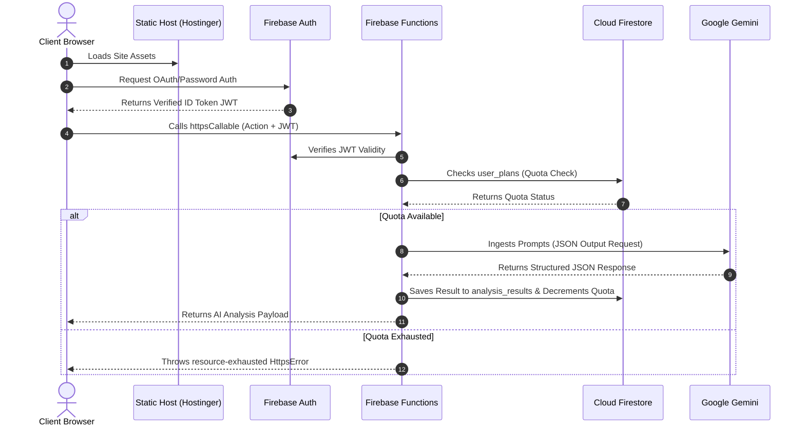

# AIVI Career Intelligence OS - Comprehensive Technical Documentation

This document serves as the definitive technical reference, system manual, and handover playbook for the AIVI Career Intelligence OS. It details the system architecture, code-level implementation, database schemas, API references, security protocols, deployment configs, and development workflows.

---

## Table of Contents
1. [Executive Summary](#1-executive-summary)
2. [Problem This App Solves](#2-problem-this-app-solves)
3. [Product Positioning](#3-product-positioning)
4. [Landing Page](#4-landing-page)
5. [Technology Stack](#5-technology-stack)
6. [Current Environment Configuration](#6-current-environment-configuration)
7. [Repository Structure](#7-repository-structure)
8. [Backend Technology Stack](#8-backend-technology-stack)
9. [Frontend Technology Stack](#9-frontend-technology-stack)
10. [High-Level Architecture](#10-high-level-architecture)
11. [Authentication and Role Flow](#11-authentication-and-role-flow)
12. [Design System and UI Direction](#12-design-system-and-ui-direction)
13. [Core Modules](#13-core-modules)
14. [External APIs and Services Used](#14-external-apis-and-services-used)
15. [Data Architecture](#15-data-architecture)
16. [File Upload and Document Lifecycle](#16-file-upload-and-document-lifecycle)
17. [Security and Permissions](#17-security-and-permissions)
18. [Rate Limiting and Quotas](#18-rate-limiting-and-quotas)
19. [API Architecture](#19-api-architecture)
20. [API Reference](#20-api-reference)
21. [Frontend Product Experience](#21-frontend-product-experience)
22. [Environment Variables](#22-environment-variables)
23. [Local Development Runbook](#23-local-development-runbook)
24. [Manual QA Checklist](#24-manual-qa-checklist)
25. [Security Rules That Must Never Be Broken](#25-security-rules-that-must-never-be-broken)
26. [Process We Are Following](#26-process-we-are-following)
27. [Production Deployment Checklist](#27-production-deployment-checklist)
28. [Current Deployment](#28-current-deployment)
29. [Known Production Gaps / Decisions](#29-known-production-gaps--decisions)
30. [What The Product Does Not Yet Fully Do](#30-what-the-product-does-not-yet-fully-do)
31. [Common Errors And Fixes](#31-common-errors-and-fixes)
32. [Production Deployment Guidance](#32-production-deployment-guidance)
33. [Production Launch Checklist](#33-production-launch-checklist)

---

## 1. Executive Summary

AIVI (Artificial Intelligence Visibility Insights) is the definitive **Career Intelligence OS**. Beyond a traditional keyword-stuffing resume builder, AIVI acts as an autonomous career coach, copywriter, and strategist. 

### 1.1. Core Promise
To enable candidates to reverse-engineer recruiter expectations, applicant tracking systems (ATS), and industry standards to score, evaluate, and iteratively optimize their entire professional footprint.

### 1.2. Target Audience
* **Active Job Seekers**: Experiencing low call-back rates and needing immediate ATS-level optimizations.
* **Mid-Level Professionals**: Working to shift industries or transition into management roles by translating their achievements into leadership metrics.
* **Recent Graduates / Freshers**: Entry-level candidates needing assistance to frame academic projects into concrete, quantified professional achievements.

---

## 2. Problem This App Solves

Job seekers face highly disjointed ecosystems that result in fragmented and inefficient application strategies:
* **Detached Tools**: Resume builders rewrite content but fail to gauge job description alignment. Job-fit scanners score alignment but force candidates to use external tools to implement changes.
* **Lack of Quantified Impact**: Candidates struggle to format achievements into the industry-standard "Action + Metric + Result" (STAR) structure.
* **Opaque ATS Filters**: Candidates remain unaware of specific hard skill and tooling keywords required to pass automatic filtering algorithms.
* **Inbound Weakness**: Passive profiles (e.g. LinkedIn profiles) remain poorly indexed, resulting in a lack of inbound recruiter interest.

---

## 3. Product Positioning

AIVI positions itself as an integrated, secure, and low-friction ecosystem that connects analytics directly to immediate, generative action.

| Dimension | AIVI Position |
|---|---|
| **Category** | Integrated Career Intelligence OS |
| **Primary Competitors** | Standalone Resume Builders, ATS Scanners, Mock Interview Sites |
| **Unique Selling Proposition (USP)** | **The Connected Loop**: Scan a resume against a target job description, determine specific skill gaps, generate a 30/60/90 learning roadmap, and instantly rebuild a tailored resume from that same job-fit context. |
| **Pricing Edge** | High-density AI consulting value at a fraction of the price of human resume writers (INR 399/mo Starter vs INR 15,000+). |

---

## 4. Landing Page

The Landing Page introduces AIVI’s core value propositions, product features, conversion funnels, and pricing models:
* **Hero Section**: Showcases the core headline promise with a direct call to action to boost the user's career rating and access the workspace.
* **Features Grid**: Outlines the three pillars of the ecosystem: Analysis (Resume Intelligence, Job Fit), Rebuild (Resume Studio), and Prep (Skill Roadmap, Interview Prep).
* **Pricing Matrices**: Details the **Starter** (INR 399/mo) and **Pro** (INR 599/mo) plan configurations.
* **Conversion Funnels**: Public CTA buttons route directly to the `/auth` page. SEO bottom-of-funnel pages distribute internal link equity (e.g. `/resume-scoring-software`, `/ai-resume-builder-for-freshers`).

---

## 5. Technology Stack

AIVI is built on a modern, decoupled web architecture:

* **Programming Languages**: TypeScript, JavaScript (Vite Client & serverless Node.js Cloud Functions).
* **Frontend Framework**: React 18, Vite (build engine).
* **Styling & Components**: Tailwind CSS, local custom UI components (shadcn/ui style, Radix UI primitives, Lucide React icons, Framer Motion).
* **Database & Auth**: Cloud Firestore (NoSQL database), Firebase Authentication.
* **Backend Functions**: Node.js Firebase Cloud Functions (v2 HTTPS Callables).
* **AI Model**: Google Gemini API via `gemini-2.5-flash` model.
* **Payments**: Razorpay Payment Gateway integration.
* **Email Provider**: SMTP-based mailing server (Nodemailer).

---

## 6. Current Environment Configuration

```
┌────────────────────────────────────────────────────────┐
│                   Local Development                    │
│  - Environment: .env.local                             │
│  - Firebase Emulator: Suite running locally            │
│  - Frontend Server: Vite running at localhost:5173     │
└──────────────────────────┬─────────────────────────────┘
                           │ Deploy Staging
                           ▼
┌────────────────────────────────────────────────────────┐
│                        Staging                         │
│  - Environment: Firebase Hosting (aivi-career.web.app) │
│  - Firebase Functions: Live staging GCP instances      │
└──────────────────────────┬─────────────────────────────┘
                           │ Deploy Production
                           ▼
┌────────────────────────────────────────────────────────┐
│                       Production                       │
│  - Environment: Hostinger Apache (www.aivilabs.com)    │
│  - Firebase Auth Action Redirect: .htaccess            │
│  - Database & Backend: Live GCP Firebase Console       │
└────────────────────────────────────────────────────────┘
```

* **Staging Configuration**: Lives on Firebase Hosting at `https://aivi-career.web.app` and coordinates with Cloud Functions.
* **Production Configuration**: The client React build resides on **Hostinger** at `https://www.aivilabs.com/`. Email verification redirects and CORS policies are controlled by the server's `.htaccess` file.
* **Configuration Files**:
  * `firebase.json`: Hosting routing rules, redirects, rewrite routes, and CSP headers.
  * `.htaccess`: Apache web server routing, security headers, and rewrite redirects.

---

## 7. Repository Structure

```
aivi-career/
├── .env.local                    # Local client environment config (ignored)
├── .firebaserc                   # Firebase active project targets
├── firebase.json                 # Firebase services, rewrites, and CSP settings
├── firestore.rules               # Database read/write access control rules
├── firestore.indexes.json        # Compiled Firestore indexes
├── package.json                  # Root npm scripts and dependencies
├── tailwind.config.ts            # Tailwind styling systems
├── public/                       # Static public assets
│   ├── .htaccess                 # Hostinger Apache rewrites, CSP, and redirects
│   ├── robots.txt                # Search index crawler instructions
│   └── sitemap.xml               # SEO sitemap
├── functions/                    # Backend Firebase Cloud Functions project
│   ├── package.json              # Functions node dependencies
│   ├── tsconfig.json             # TypeScript settings for functions
│   └── src/                      # Functions TypeScript source code
│       ├── index.ts              # Entry points, callable APIs, and triggers
│       ├── payments/
│       │   └── razorpay.ts       # Razorpay order creators and webhooks
│       ├── privacy/
│       │   └── deleteAccount.ts  # User account deletion cleanup
│       └── security/
│           ├── aiGuards.ts       # Gemini API cost and budget safeguards
│           ├── auth.ts           # Verification & RBAC admin checks
│           ├── errors.ts         # Logging wrapper for server errors
│           ├── rateLimit.ts      # Cloud Function rate limiter
│           └── validators.ts     # Request schema validations via Zod
└── src/                          # Frontend React client project
    ├── main.tsx                  # Client entry point
    ├── App.tsx                   # Routes, providers, and layout loads
    ├── components/               # UI components and forms
    ├── contexts/
    │   └── AuthContext.tsx       # Authentication status context provider
    ├── integrations/
    │   └── firebase/
    │       └── client.ts         # Browser SDK Firebase Config
    ├── layouts/
    │   └── DashboardLayout.tsx   # Dashboard navigation structure
    ├── pages/                    # Marketing pages & product modules
    ├── services/
    │   ├── analysisService.ts    # Frontend call wrappers to Cloud Functions
    │   ├── paymentService.ts     # Checkout triggers and order loaders
    │   └── planService.ts        # Quota checks and coupon trial claimed logic
    └── utils/
        ├── jobFitScoring.ts      # Client-side match percentage algorithm
        ├── pdfParser.ts          # PDF binary parser triggers
        └── resumeExport.ts       # jsPDF & docx compiler builder
```

---

## 8. Backend Technology Stack

The backend is built as a serverless Cloud Functions application.

* **Framework**: Node.js runtime served by Firebase Cloud Functions (v2).
* **API Validation**: Zod schema parser validation.
* **Authentication**: Decoded Firebase Auth ID tokens verified via the `firebase-admin` SDK.
* **Database Access**: Firestore Admin SDK (bypasses Firestore security rules to commit atomic changes).
* **Storage & Parsing**: Node binary processing. PDF documents are received as Base64 arrays and parsed using `pdfjs-dist`.
* **Logging & Telemetry**: Cloud Logging captures error payloads. Asynchronous usage telemetry is stored in the `ai_usage_logs` collection.

---

## 9. Frontend Technology Stack

The frontend is a modern, high-performance Single Page Application (SPA).

* **Framework**: React 18, TypeScript, and Vite.
* **Routing**: Client-side navigation via `react-router-dom` (v6).
* **Data Fetching**: `@tanstack/react-query` handles caching, background updates, and request loading state tracking.
* **Styling & UI**: Tailwind CSS, Radix UI primitive modules, and custom components.
* **Verification & Logic**: Forms utilize React Hook Form coupled with Zod validation. PDF and Word document formatting exports are handled on the client using `jspdf` and `docx`.

---

## 10. High-Level Architecture

The diagrams below represent the user flow and interactive communications:

### 10.1. Request Flow



---

## 11. Authentication and Role Flow

Authentication and authorization are managed securely through Firebase:

* **Authentication Methods**: Support for Email/Password registration (requiring email verification) and Google OAuth provider.
* **Role-Based Access Control (RBAC)**: Users default to the `user` role. Custom roles are assigned in `user_roles/{userId}` (e.g. `role: "admin"`).
* **Access Checks**:
  * Cloud Functions check `requireVerifiedAuth()` (verifies email verification status) and `requireAdmin()` (reads `user_roles` collection to permit access).
  * Firestore rules block client reads/writes on collections except based on matching `request.auth.uid`.
* **Session Persistence**: Set to `browserLocalPersistence` in the client SDK initialization, keeping sessions alive across tabs.

---

## 12. Design System and UI Direction

AIVI features a premium dark-themed aesthetic:

* **Aesthetic Principle**: High-fidelity, clean layout using dark Slate backgrounds combined with bright accent colors.
* **Palette**: 
  * Background: Slate-950 (`#020617`) and Zinc-900 (`#18181b`).
  * Primary Accent: Neon Orange-Coral (`#FF6D4A`).
  * Secondary Accent: Muted Teal (`#169C8F`).
* **Typography**: Outfit and Inter fonts loaded via Google Fonts.
* **Transitions**: Smooth micro-animations and page loads powered by Framer Motion.

---

## 13. Core Modules

### 13.1. Resume Intelligence (`/dashboard/resume`)
* **Purpose**: Performs a deep ATS-level analysis of a resume.
* **Implementation**: Uses Zod to parse schemas. Prompt evaluates keywords, impact statements, and formatting gaps.
* **Client Files**: `src/pages/ResumeIntelligence.tsx`, `src/components/ResumeUploadForm.tsx`
* **API Endpoint**: `careerAnalysis` (with `analysis_type: "resume"`)

### 13.2. Resume Studio (`/dashboard/builder`)
* **Purpose**: Generates tailored, impact-optimized resume content using the STAR method.
* **Implementation**: Generates complete resume structures based on target role, current experience, and customization prompts.
* **Client Files**: `src/pages/ResumeBuilder.tsx`
* **API Endpoint**: `careerAnalysis` (with `analysis_type: "resume_rebuild"`)

### 13.3. Job Fit Analysis (`/dashboard/job-fit`)
* **Purpose**: Compares resumes against job descriptions to calculate match percentages.
* **Implementation**: Computes match metrics on the client via `jobFitScoring.ts` based on Gemini's structured analysis.
* **Client Files**: `src/pages/JobFitAnalysis.tsx`, `src/utils/jobFitScoring.ts`
* **API Endpoint**: `careerAnalysis` (with `analysis_type: "job_fit"`)

### 13.4. Skill Roadmap (`/dashboard/roadmap`)
* **Purpose**: Bridges identified skill gaps with a 30/60/90-day learning curriculum.
* **Client Files**: `src/pages/SkillRoadmap.tsx`
* **API Endpoint**: `careerAnalysis` (with `analysis_type: "roadmap"`)

### 13.5. Interview Prep (`/dashboard/interview`)
* **Purpose**: Generates custom behavioral and technical question sets.
* **Client Files**: `src/pages/InterviewPrep.tsx`
* **API Endpoint**: `careerAnalysis` (with `analysis_type: "interview"`)

### 13.6. Promotion Readiness (`/dashboard/promotion`)
* **Purpose**: Evaluates candidate achievements against higher-level roles.
* **Client Files**: `src/pages/PromotionReadiness.tsx`
* **API Endpoint**: `careerAnalysis` (with `analysis_type: "promotion"`)

### 13.7. Portfolio Analyzer (`/dashboard/portfolio`)
* **Purpose**: Audits external developer or designer links (GitHub, Behance, personal sites).
* **Client Files**: `src/pages/PortfolioAnalyzer.tsx`
* **API Endpoint**: `careerAnalysis` (with `analysis_type: "portfolio"`)

### 13.8. LinkedIn Analyzer (`/dashboard/linkedin`)
* **Purpose**: Audits and generates optimized copy for LinkedIn profiles.
* **Client Files**: `src/pages/LinkedInAnalyzer.tsx`
* **API Endpoints**: `linkedinAnalyze` and `linkedinOptimize`

---

## 14. External APIs and Services Used

| Service | Purpose | Connection Method | Security |
|---|---|---|---|
| **Google Gemini API** | LLM generation and JSON response structures. | HTTPS Post via `@google/generative-ai` SDK. | API Key stored as Firebase Secret (`GEMINI_API_KEY`). |
| **Razorpay API** | Payment order generation and subscription webhook processing. | Node HTTPS client and signed events. | API Secret stored as Firebase Secret (`RAZORPAY_KEY_SECRET`, `RAZORPAY_WEBHOOK_SECRET`). |
| **Nodemailer SMTP** | Sends contact form confirmations and notification emails. | SMTP transport connection. | Passwords stored as Firebase Secret (`SMTP_PASSWORD`). |

---

## 15. Data Architecture

Persisted data is managed in Cloud Firestore:

```
                               Firestore Schema
                               
   profiles                     user_plans                   user_roles
 ┌──────────────────────┐     ┌──────────────────────┐     ┌──────────────────────┐
 │ userId (UID)         │     │ userId (UID)         │     │ userId (UID)         │
 │ fullName             │     │ planType             │     │ role                 │
 │ email                │     │ monthlyAnalysisUsed  │     │ createdAt            │
 │ createdAt            │     │ monthlyResetDate     │     └──────────────────────┘
 │ updatedAt            │     │ trial                │
 └──────────────────────┘     │ trialExpiresAt       │
                              │ trialUsed            │
                              │ billing_status       │
                              │ paid_until           │
                              │ lifetime_resume_cnt  │
                              │ lifetime_jobfit_cnt  │
                              │ ...                  │
                              └──────────────────────┘
                              
   analysis_results             ai_usage_logs                payment_orders
 ┌──────────────────────┐     ┌──────────────────────┐     ┌──────────────────────┐
 │ userId               │     │ userId               │     │ userId               │
 │ analysisType         │     │ endpoint             │     │ planType             │
 │ result (Map)         │     │ prompt_tokens        │     │ amount               │
 │ scores (Map)         │     │ completion_tokens    │     │ currency             │
 │ contentHash          │     │ costUsd              │     │ status               │
 │ createdAt            │     │ timestamp            │     └──────────────────────┘
 └──────────────────────┘     └──────────────────────┘
```

* **Relations**: No SQL-like table mappings exist. Collection documents include a `userId` field linking back to the user's Auth profile.
* **Data Lifecycle**: Static document creation. When a user account is deleted via `deleteMyAccount`, all related documents (profiles, plans, results) are removed via batch operations.

---

## 16. File Upload and Document Lifecycle

File uploads are handled entirely in memory:

1. **Upload Selection**: The user selects a PDF file via `ResumeUploadForm.tsx`.
2. **Client Conversion**: The file is read via JavaScript `FileReader` and converted to a base64 string.
3. **API Processing**: The base64 string is sent to `extractPdf`. The Cloud Function loads `pdfjs-dist` to extract text.
4. **Validation**: Zod schema checks base64 string structure and length (min 100 bytes, max 12MB).
5. **No Persistent Storage**: Extracted text is returned to the client and uploaded files are never saved, eliminating permanent data storage risks.

---

## 17. Security and Permissions

AIVI operates under a strict **Zero Trust** security model:

* **No Client Database Writes**: Write rules for `user_plans`, `analysis_results`, `ai_usage_logs`, and payments are set to `allow write: if false;`. Updates are restricted to server-side Cloud Functions using the `firebase-admin` SDK.
* **Strict Content Security Policy (CSP)**: Set in both `firebase.json` and `.htaccess` to block unauthorized cross-site scripting (XSS) and frame injection:
  ```text
  default-src 'self'; 
  script-src 'self' 'unsafe-inline' https://www.googletagmanager.com https://www.google-analytics.com https://checkout.razorpay.com https://apis.google.com https://accounts.google.com; 
  connect-src 'self' https://*.googleapis.com https://*.firebaseio.com https://*.cloudfunctions.net https://checkout.razorpay.com; 
  frame-src 'self' https://aivi-career.firebaseapp.com https://accounts.google.com https://api.razorpay.com https://checkout.razorpay.com;
  ```
* **Hostinger Redirect Rules**: A rewrite rule in `.htaccess` intercepts email verification links (`/__/auth/action`) and redirects them to the Firebase Hosting server (where the auth handlers reside):
  ```apache
  RewriteRule ^/?__/auth/action(.*)$ https://aivi-career.firebaseapp.com/__/auth/action$1 [R=302,L,NE]
  ```

---

## 18. Rate Limiting and Quotas

To prevent API abuse and token depletion, the following limits are enforced:

### 18.1. API Call Quotas
The `checkUsageInline` function runs a transactional verification check before calling the Gemini API:

| Plan Type | Limit Target | Action Check |
|---|---|---|
| **Free** | `2` analyses/mo | Enforces standard token limit checks on Resume/Job-Fit. |
| **Starter** | `30` analyses/mo | Trial claim is capped at 1,000 users via Firestore transactions. |
| **Pro** | Unlimited / High Volume | Controlled through Razorpay subscription statuses. |

### 18.2. DDoS Prevention
A Firestore-backed rate limiter (`rateLimit.ts`) tracks IP addresses and UIDs, restricting rapid calls to sensitive endpoints.

---

## 19. API Architecture

AIVI backend endpoints are built using **v2 Firebase Cloud Functions**:

* **Structure**: Enforces HTTPS callable handlers (`onCall`) requiring JSON body payloads.
* **Payload Parsing**: Request validation is strictly enforced using Zod schemas.
* **Error Handling**: Internal errors are captured and logged. Validations or quota failures return standardized `HttpsError` exceptions (e.g. `invalid-argument`, `resource-exhausted`).

---

## 20. API Reference

All backend functions are Firebase HTTPS Callable v2 endpoints, except `razorpayWebhook` and `healthz` (which are standard HTTPS request triggers).

### 20.1. `careerAnalysis`
* **Auth Required**: Yes (verified email required).
* **Payload**:
  ```json
  {
    "analysis_type": "resume" | "job_fit" | "roadmap" | "interview" | "promotion" | "portfolio" | "resume_rebuild",
    "resume_text": "string (optional)",
    "job_description": "string (optional)",
    "current_role": "string (optional)",
    "target_role": "string (optional)",
    "projects": [{"name": "string", "description": "string"}] (optional)
  }
  ```
* **Response**:
  ```json
  {
    "result": { ... },
    "cached": false,
    "content_hash": "string"
  }
  ```
* **Errors**: `unauthenticated`, `permission-denied` (unverified email), `resource-exhausted` (quota limit exceeded).

### 20.2. `linkedinAnalyze`
* **Auth Required**: Yes.
* **Payload**: `{ "profileText": "string" }`
* **Response**: `{ "analysisId": "string", "result": { ... }, "cached": false }`

### 20.3. `linkedinOptimize`
* **Auth Required**: Yes.
* **Payload**: `{ "analysisId": "string", "targetRole": "string (opt)", "industry": "string (opt)" }`
* **Response**: `{ "optimizeId": "string", "result": { ... } }`

### 20.4. `extractPdf`
* **Auth Required**: Yes.
* **Payload**: `{ "pdf_base64": "base64-string" }`
* **Response**: `{ "text": "extracted-text-string" }`

### 20.5. `applyCoupon`
* **Auth Required**: Yes.
* **Payload**: `{ "code": "FIRST1000" }`
* **Response**: `{ "success": true, "message": "Coupon applied" }`

### 20.6. `createPaymentOrder`
* **Auth Required**: Yes.
* **Payload**: `{ "planType": "starter" | "pro" }`
* **Response**: `{ "orderId": "rzp_id", "amount": 39900, "currency": "INR", "keyId": "rzp_key" }`

### 20.7. `razorpayWebhook`
* **Auth Required**: No (verifies signature headers).
* **Method**: `POST`
* **Headers**: `x-razorpay-signature`
* **Response**: `200 OK` (Processes order and updates target `user_plans` document).

---

## 21. Frontend Product Experience

AIVI's user experience is designed to minimize friction:

* **Interactive Radar Charts**: Visualizes job fit comparison scores across technical skills and experience.
* **Resume Studio Workbench**: Allows users to dynamically update resume parameters and regenerate content.
* **History Log Cards**: Enables users to retrieve cached Gemini results without consuming additional quotas.
* **Loading States**: Includes skeleton animations during PDF text extraction and AI content generation.

---

## 22. Environment Variables

Below is the environment variable mapping schema:

| Variable Name | Target Service | Purpose | Required? | Example | Security Note |
|---|---|---|---|---|---|
| `VITE_FIREBASE_API_KEY` | Client SDK | Initializes Firebase app client. | Yes | `AIzaSyC8...` | Public identifier (no secret). |
| `VITE_USE_FIREBASE_EMULATOR` | Client SDK | Directs client to local emulators. | Yes | `false` | Development use only. |
| `GEMINI_API_KEY` | Cloud Functions | Authenticates calls to Gemini API. | Yes | `AIzaSy...` | Stored as a Firebase Secret. |
| `RAZORPAY_KEY_SECRET` | Cloud Functions | Authenticates API requests to Razorpay. | Yes | `sk_live...` | Stored as a Firebase Secret. |
| `RAZORPAY_WEBHOOK_SECRET` | Cloud Functions | Validates signed Razorpay webhook calls. | Yes | `whsec_...` | Stored as a Firebase Secret. |
| `SMTP_PASSWORD` | Cloud Functions | Authenticates Nodemailer mail client. | No | `pass123` | Stored as a Firebase Secret. |

---

## 23. Local Development Runbook

Follow these steps to run AIVI in a local development environment:

### 23.1. Initial Installation
1. Install project dependencies in the root directory:
   ```bash
   npm install
   ```
2. Install Cloud Function dependencies:
   ```bash
   npm --prefix functions install
   ```
3. Copy `.env.example` to `.env.local` and add your public Firebase project keys.

### 23.2. Running Local Emulators
1. Set `VITE_USE_FIREBASE_EMULATOR=true` in your `.env.local` file.
2. In a terminal window, launch the Firebase emulator suite:
   ```bash
   firebase emulators:start
   ```
3. In a separate terminal, launch the local React server:
   ```bash
   npm run dev
   ```

### 23.3. Compiling and Verifying
```bash
# Run security verifications
npm run security:verify

# Run test suite
npm test

# Build Vite static assets
npm run build
```

---

## 24. Manual QA Checklist

Before deploying changes, verify the following checklist items:

### 24.1. Authentication
- [ ] Direct sign-up sends a verification email.
- [ ] Unverified accounts cannot access `/dashboard` paths.
- [ ] Google OAuth sign-in works correctly.

### 24.2. Routing & CSP
- [ ] Reloading direct pages (e.g. `/dashboard/resume`) on Hostinger does not throw a 404 error.
- [ ] Email verification links redirect from Hostinger to Firebase Hosting.
- [ ] Browser console does not throw CSP frame violation errors during payment checkout or Google sign-in.

### 24.3. Quota Processing
- [ ] Running a career analysis increments the user's `monthlyAnalysisUsed` counter.
- [ ] Out-of-quota accounts are redirected to the Upgrade modal.
- [ ] Coupon claims are capped at 1,000 users.

---

## 25. Security Rules That Must Never Be Broken

The following security principles must be strictly enforced at all times:

1. **Never scan unverified domains.**
2. **Never accept localhost, private network, internal network, or loopback targets from users.**
3. **Never hardcode secrets.**
4. **Never expose Firebase Admin credentials to the frontend.**
5. **Never expose Gemini API secrets to the frontend.**
6. **Never expose Razorpay secrets to the frontend.**
7. **Never allow one user to access another user's domains, scans, findings, reports, billing, GitHub repositories, or private data.**
8. **Never store real user passwords for third-party websites.**
9. **For authenticated scans, prefer session cookies, access tokens, or dedicated test accounts, and always redact sensitive values.**
10. **Never log full access tokens, cookies, API keys, or private keys.**
11. **Always enforce scanner concurrency limits.**
12. **Always implement stale scan recovery.**
13. **Always preserve raw scanner results for auditing and debugging.**
14. **Always label low-confidence findings honestly.**
15. **Never present inferred results as confirmed vulnerabilities.**

---

## 26. Process We Are Following

To maintain code quality and security, follow this development workflow:

* **Branching Strategy**: Branch names must use the `codex/` prefix (e.g. `codex/security-containment`).
* **Code Verification**: Every commit must pass the `npm run security:verify` check.
* **Testing Invariant**: Modifications to database rules or endpoints require running unit tests (`npm test`) before deployment.

---

## 27. Production Deployment Checklist

Verify the following items before deploying to production:

- [ ] All environment secrets are set in Firebase Functions.
- [ ] Build files are compiled successfully (`npm run build`).
- [ ] Firestore security rules are deployed and deny direct client-side writes.
- [ ] `.htaccess` contains the `302` redirect rule and updated CSP headers.
- [ ] Razorpay webhook endpoints point to the live `razorpayWebhook` function URL.

---

## 28. Current Deployment

AIVI runs on a hybrid hosting architecture:

* **Static Files Hosting**: Served by Hostinger Apache servers at `https://www.aivilabs.com/`.
* **Backend Services**: Hosted on Google Cloud Platform via Firebase v2 Cloud Functions.
* **Database & Auth**: Served directly from Firebase Console.

---

## 29. Known Production Gaps / Decisions

The following items are identified as technical debt or open decisions:
* **Dependency Audits**: High vulnerabilities exist in `vite`, `@grpc/grpc-js`, and `form-data` dependencies. These should be updated in a future maintenance sprint.
* **Stale Session Handling**: Emulators run without sessions; session expiry bounds should be configured in Google Identity Provider settings.

---

## 30. What The Product Does Not Yet Fully Do

The following features are partially implemented or planned:
* **Resume Studio (Phase 2)**: Before/after change logs, and accepting/rejecting specific AI-generated recommendations.
* **Vocal Mock Interview Simulator**: Audio recording analysis (currently text-only).
* **Multi-Currency Billing**: Support for international checkout currencies (currently restricted to INR).

---

## 31. Common Errors And Fixes

### 31.1. User Signups Crashing
* **Error**: `onUserSignupComplete` Cloud Function fails to run, causing signup initialization to fail.
* **Cause**: Mixing client and admin SDK formats in serverless triggers.
* **Fix**: Use native JavaScript Date objects (`new Date()`) instead of Firestore field values (`admin.firestore.FieldValue.serverTimestamp()`).

### 31.2. Firebase Auth CSP Block
* **Error**: Gmail sign-in popups fail to authorize, throwing `auth/internal-error`.
* **Cause**: Restrictive CSP policies block Firebase Authentication iframes from loading.
* **Fix**: Whitelist `aivi-career.firebaseapp.com` in your CSP rules.

---

## 32. Production Deployment Guidance

1. Set production GCP environment configurations:
   ```bash
   firebase functions:secrets:set GEMINI_API_KEY="key"
   ```
2. Build the project:
   ```bash
   npm run build
   ```
3. Deploy Firestore configurations and functions:
   ```bash
   firebase deploy --only firestore:rules,firestore:indexes,functions
   ```
4. Compress and upload the `/dist` directory to your Hostinger server.

---

## 33. Production Launch Checklist

Before launching:

- [ ] Run a test payment order flow using Razorpay test keys.
- [ ] Verify that Google OAuth logins work correctly on `https://www.aivilabs.com/`.
- [ ] Confirm Firestore backup workflows are active.
- [ ] Enable billing and usage alerts in the Google Cloud Console.
