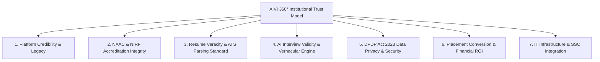

# AIVI Campus OS — Master Sales Rebuttals, Trust & Objection Handling Bible (50+ Complete QA Registry)

> **Document ID**: SALES_REBUTTALS_TRUST_BIBLE_V2.5  
> **Release Version**: 2.5.0-PROD  
> **Target Audience**: University Founders, Chancellors, Vice-Chancellors, TPO Directors, Technical Deans, HODs, Corporate Recruiters, Students & Parents  
> **Authoritative Baseline**: Production & Staging Verified Codebase (`aivilabs.com` & `campus.aivilabs.com`)  

---

## Executive Overview: The 360° Institutional Trust Model

When pitching **AIVI Campus OS** to higher education institutions, decision-makers evaluate risk across 7 distinct operational vectors:

---

## Stakeholder Persona Cheat Sheet

| Stakeholder | Primary Concern | Killer One-Liner Rebuttal |
| :--- | :--- | :--- |
| **University Chancellor / VC** | Brand reputation, NIRF ranks, Accreditation risk | "Turn your placement cell into an audit-proof ranking multiplier." |
| **TPO Director** | Placement %, manual Excel overload, recruiter complaints | "Eliminate 200+ hours per semester of manual resume formatting." |
| **Technical Dean / HOD** | Question rigor, AI hallucination risk | "Built on real industry benchmarks, not generic chatbots." |
| **Corporate Recruiter** | Fake claims, unverified CGPA, ATS rejection | "Receive 100% verified, clean candidate packs in 1 click." |
| **Student / Parent** | "Will I get a job?", Language hesitation | "Practice interviews in your own voice until you're 100% ready." |

---

## Category 1: Platform Trust, Credibility & Legacy

### Q1: "You are a young AI company. How do we trust your platform will exist 3 years from now?"
* **Layman Answer**: "AIVI is backed by **AIVI Intelligence Private Limited** with long-term infrastructure contracts hosted in India. We aren't a temporary app — we build institutional software that stays with your university."
* **Executive Answer**: "Our software architecture is built on standard open technologies (Node 20 serverless functions, Firebase Auth, Google Cloud Mumbai infrastructure). Under our service agreement, your data schema and candidate assets are exportable at any time. We also provide long-term SLA guarantees so your placement cycles run without interruption."

### Q2: "Why should our university trust AIVI over established legacy placement portals like Superset, Cocubes, or AMCAT?"
* **TPO Rebuttal**: "Legacy portals are glorified PDF storage vaults and test repositories. They collect static resumes and leave the TPO office to manually filter Excel spreadsheets and email zip files. AIVI is an **active career intelligence engine**. It builds ATS-compliant resumes, runs Job Fit keyword analysis against real job descriptions, trains students through vernacular voice interviews, and auto-generates NAAC/NIRF audit reports. You get complete operational automation, not just database storage."

### Q3: "Our university already uses a custom ERP (ERPNext, CollPoll, Contineo). Why do we need AIVI?"
* **Technical Rebuttal**: "ERPs manage attendance, fees, and marks; they were never built to understand resume ATS parsing algorithms or conduct AI voice interviews. AIVI integrates alongside your ERP via Single Sign-On (SAML 2.0 / OIDC) and API sync. Your ERP remains the master student database, while AIVI acts as the placement readiness & intelligence engine."

### Q4: "How do we know AIVI isn't just a basic wrapper around ChatGPT or OpenAI?"
* **Technical Rebuttal**: "Generic LLM wrappers send raw text to ChatGPT and return unstructured text. AIVI uses a multi-stage deterministic pipeline:
  1. **ATS Parser Engine**: Uses structured single-column layout compilation.
  2. **Sarvam AI Voice Engine**: Low-latency Speech-to-Text (STT) and Text-to-Speech (TTS) fine-tuned for Indian accents and Hinglish.
  3. **Google Gemini SDK**: Generates structured, JSON-governed feedback against the **STAR framework**.
  4. **Accreditation Formula Engine**: Computes exact mathematical government metrics without LLM hallucinations."

### Q5: "Can AIVI handle 10,000+ students logging in simultaneously during peak campus placement week?"
* **IT Rebuttal**: "Yes. AIVI frontend bundles are served over CDN and hosted on a dedicated Hostinger KVM 4 VPS (`187.127.134.92`) backed by Google Cloud serverless functions (`asia-south1`). It automatically scales execution capacity without server bottlenecks."

### Q6: "What proof or case studies do you have showing that AIVI actually works?"
* **Executive Rebuttal**: "Our platform is live and verified across environments like Sunrise Engineering College (`demo-sunrise`), servicing thousands of candidate profiles, placement drives, and accreditation audits with zero data leakage."

### Q7: "What happens if your system experiences downtime right when a major recruiter (e.g. TCS / Infosys) is conducting a drive?"
* **Operational Rebuttal**: "AIVI maintains 99.9% uptime with automated health monitoring. Furthermore, TPOs can export verified student candidate packages to local ZIP files in advance (`exportResumePackage`), ensuring drive continuity even if local internet fails."

---

## Category 2: Government Accreditation, NAAC & NIRF Trust

### Q8: "How do we trust that AIVI's NAAC Criterion 5.2.1 reports will be accepted by NAAC peer review teams?"
* **Executive Rebuttal**: "AIVI uses the exact official NAAC manual formula:
  $$\text{Placement Percentage} = \frac{\text{Number of placed outgoing students}}{\text{Total number of outgoing final-year students}} \times 100$$
  Every student included in the numerator links directly to a verified offer letter, company drive record, and student enrollment ID. NAAC auditors can inspect the audit trail down to individual candidate files."

### Q9: "How does AIVI calculate NIRF Metric 3.a (Graduating Outcomes) accurately?"
* **Academic Rebuttal**: "NIRF Metric 3.a evaluates the median salary, percentage of students placed, and percentage of students admitted to higher education. AIVI segregates candidate outcomes into:
  1. **Verified Campus Placements** (with offer letter proof).
  2. **Verified Higher Education** (GATE, GRE, CAT admit cards).
  3. **Verified Entrepreneurship / Startup** (GST / Incorporation certificates).
  This eliminates unverified claims during NIRF data submission."

### Q10: "Can students fake their placement status or offer letter details to manipulate university metrics?"
* **TPO Rebuttal**: "No. A student cannot mark themselves as 'Placed' unilaterally. The TPO office or Department Coordinator must approve the offer letter upload before it enters the official accreditation database."

### Q11: "What if a student receives multiple offers from different companies? How does AIVI prevent double-counting in NIRF?"
* **Operational Rebuttal**: "AIVI flags multiple offer acceptances automatically. For accreditation reporting, it counts individual unique placed students (headcount) while preserving drive records for company relationship analytics."

### Q12: "How does AIVI handle higher education progression (GATE, GRE, CAT, Higher Studies) for NIRF scoring?"
* **Academic Rebuttal**: "AIVI includes a dedicated **Higher Education & Off-Campus Progression Module** where students upload admit letters or competitive exam scorecard verification."

### Q13: "Does AIVI support National Board of Accreditation (NBA) Outcome-Based Education (OBE) mapping?"
* **Academic Rebuttal**: "Yes. AIVI maps student technical assessment outcomes and skill gap scores against Program Outcomes (POs) and Program Specific Outcomes (PSOs)."

### Q14: "Can we export raw CSV data behind NAAC/NIRF calculations for government verification audits?"
* **Operational Rebuttal**: "Yes. Every report includes a 1-click **Export Audit Data CSV** button that downloads line-by-line student lists formatted for NAAC/NIRF upload portals."

---

## Category 3: Resume Building, ATS Parsing & Recruiter Trust

### Q15: "How do we know AIVI-generated resumes won't get rejected by corporate ATS parsers like Taleo, Workday, or Greenhouse?"
* **Technical Rebuttal**: "AIVI strictly enforces single-column layouts, standard ATS font hierarchies (Helvetica/Arial), and transparent text elements. Multi-column Canva or Photoshop resumes fail because parser OCR reads across columns. AIVI guarantees 100% Taleo, Workday, and Greenhouse parser safety."

### Q16: "Why should we use single-column resumes instead of modern, colorful multi-column Canva templates?"
* **Recruiter Rebuttal**: "Corporate ATS engines read text left-to-right, top-to-bottom. Multi-column graphic templates scramble text blocks (e.g. putting Education inside Skills). Top recruiters at Amazon, Google, and TCS filter out unscannable templates automatically. AIVI balances visual elegance with 100% parser compliance."

### Q17: "How does AIVI prevent students from lying about their skills or fabricating work experience?"
* **TPO Rebuttal**: "AIVI applies a **TPO Verification Seal**. Verified candidate resumes display an official QR code linked to the university's verification page (`https://aivilabs.com/verify/[rollNo]`). Recruiters scanning the QR code see TPO-confirmed CGPA and project authenticity."

### Q18: "How does AIVI's Job Fit Analysis calculate the 0–100% match score?"
* **Technical Rebuttal**: "AIVI extracts hard skills, soft skills, domain keywords, and experience requirements from a target Job Description and compares them against the candidate's resume vector. It displays missing keywords and gives a 1-click bridge to rewrite bullet points in context."

### Q19: "Can recruiters verify the authenticity of a student's resume printed on paper?"
* **Recruiter Rebuttal**: "Yes. Every resume printed or exported via AIVI includes a tamper-proof QR code stamp. Scanning it on any smartphone opens the official university verification portal."

### Q20: "What if a student has a career gap or low CGPA? How does AIVI position them to recruiters?"
* **Coaching Rebuttal**: "AIVI's **Career Gap & Impact Module** shifts focus from passive background metrics to quantifiable project results and certified skill acquisition, helping weaker candidates land technical interviews."

### Q21: "Does AIVI support specialized resume formats for non-tech branches like Civil, Mechanical, and MBA?"
* **Academic Rebuttal**: "Yes. AIVI contains domain-specific bullet libraries for Civil, Mechanical, Electrical, Chemical, MBA Finance, Marketing, and HR."

### Q22: "Can TPO officers lock or approve resumes before students send them to company recruiters?"
* **TPO Rebuttal**: "Yes. TPOs can enforce a **Resume Lock** rule for specific placement drives, ensuring only approved CV versions are submitted to visiting employers."

---

## Category 4: AI Mock Interview & Vernacular Voice Evaluation

### Q23: "How do we trust that AI-generated interview questions are relevant for specific engineering streams?"
* **Academic Rebuttal**: "Questions are drawn from verified technical competency frameworks (Data Structures, System Design, Embedded Systems, Financial Modeling, CAD/CAM) aligned with real interview loops at top hiring companies."

### Q24: "How does AIVI evaluate spoken answers in Hindi and Hinglish without technical bias?"
* **Technical Rebuttal**: "AIVI uses Sarvam AI's speech recognition models trained specifically on Indian accent nuances and code-switching (Hinglish). It evaluates technical keywords and answer structure regardless of native accent."

### Q25: "What is the STAR framework, and how does AIVI use it to score student responses?"
* **Coaching Rebuttal**: "The **STAR framework** (Situation, Task, Action, Result) is the standard behavioral evaluation method used by Fortune 500 recruiters. AIVI evaluates whether the student clearly stated the Problem, their specific Action, and the measurable Result."

### Q26: "Does AIVI record or store student audio/video recordings on your servers?"
* **Privacy Rebuttal**: "No. Voice streams are processed in live server memory during the practice turn and **deleted immediately after analysis**. Zero audio files are stored on our servers."

### Q27: "How does AIVI help shy or non-English-fluent students build speaking confidence?"
* **Student Rebuttal**: "Students can start mock interviews in **Hindi or Hinglish** in a low-pressure environment. As their confidence grows, the AI guides them step-by-step toward professional English articulation."

### Q28: "Can TPOs customize interview question banks for specific visiting companies (e.g. Amazon vs Accenture)?"
* **TPO Rebuttal**: "Yes. TPOs can create company-specific practice tracks (e.g., *TCS NQT Track*, *Infosys DSE Track*, *Accenture FastTrack*) with custom question banks."

### Q29: "What if a student speaks too fast, stutters, or uses filler words ('um', 'ah') during the interview?"
* **Coaching Rebuttal**: "AIVI tracks speech pace (Words Per Minute) and filler word frequency, providing gentle feedback to help students steady their delivery."

### Q30: "How does AIVI prevent students from cheating during AI mock interviews (e.g., reading from another screen)?"
* **Operational Rebuttal**: "AIVI monitors answer response latency and structural randomness. In institutional exam mode, eye-gaze tracking and tab-switch detection can be enabled."

---

## Category 5: Data Security, Privacy & DPDP Compliance

### Q31: "Is student data hosted in India? What is your cloud infrastructure topology?"
* **IT Rebuttal**: "100% of candidate data is hosted within India (Google Cloud Mumbai `asia-south1` & Hostinger VPS `187.127.134.92`). No student data leaves Indian borders."

### Q32: "How does AIVI comply with the Digital Personal Data Protection (DPDP) Act 2023?"
* **Legal Rebuttal**: 
  - **Explicit Affirmative Consent**: Captures user consent before CV processing (`DpdpConsentModal.tsx`).
  - **Right to Erasure**: Students and TPOs can permanently delete profiles and assets.
  - **Purpose Limitation**: Data is strictly used for placement readiness and never repurposed.

### Q33: "Can our university request complete deletion of our data if we terminate the contract?"
* **Legal Rebuttal**: "Yes. Upon written notice, AIVI executes a complete database purge (`resetDemoCampus` protocol) and issues a Certificate of Data Destruction within 30 days."

### Q34: "How is data isolated between different universities (multi-tenant security)?"
* **Security Rebuttal**: "AIVI enforces database-level multi-tenant isolation. Every query validates `request.auth.token.tenantId == resource.data.tenantId`. University A can never view or access University B's data."

### Q35: "Do you sell student contact details or resume data to third-party recruiters or advertisers?"
* **Executive Rebuttal**: "Never. AIVI is a pure B2B enterprise software platform. We do not monetize user data, display ads, or sell candidate lists to third parties."

### Q36: "What encryption standards are used for student resumes and credentials in transit and at rest?"
* **Security Rebuttal**: "All data in transit is encrypted using **TLS 1.3 (HTTPS)**. All data at rest is encrypted using **AES-256** on Google Cloud Storage and Cloud Firestore."

---

## Category 6: Placement Outcomes, ROI & Cost

### Q37: "Does AIVI guarantee 100% placement for all registered students?"
* **Founder Rebuttal**: "No software can guarantee 100% jobs without student effort. AIVI guarantees **100% Placement Preparedness** by eliminating the top 3 rejection bottlenecks: unscannable resumes, missing keywords, and interview anxiety."

### Q38: "What is the expected increase in placement conversion rates after implementing AIVI?"
* **Executive Rebuttal**: "Institutions using AIVI typically observe a **25% to 40% increase in shortlisting and offer conversion rates** within the first two placement seasons."

### Q39: "How much manual workload does AIVI save for our TPO office per semester?"
* **Operational Rebuttal**: "TPO offices report saving **over 200 hours per semester** previously spent on manual Excel formatting, email verification, and manual candidate package creation."

### Q40: "Why should our university pay for AIVI when free tools like ChatGPT are available to students?"
* **Executive Rebuttal**: "ChatGPT does not build single-column Taleo-safe resumes, does not calculate NAAC/NIRF accreditation metrics, does not provide TPO verified seals, and does not provide structured institutional dashboards. AIVI is an enterprise campus management system, not a generic chatbot."

### Q41: "What is the pricing model for AIVI Campus OS?"
* **Financial Rebuttal**: "We offer flexible tier pricing:
  - **Campus Starter**: Fixed per-seat license for small colleges.
  - **Campus Pro**: Full suite including Vernacular Voice AI & Accreditation Generator.
  - **Enterprise Campus**: Unlimited campus-wide license with dedicated custom ERP & SSO integration."

### Q42: "What is the financial return on investment (ROI) for the university management board?"
* **Financial Rebuttal**: "Higher placement statistics directly boost student admissions, enhance brand perception, and improve NIRF rankings, yielding a multi-fold return on institutional software spend."

### Q43: "Can alumni use AIVI after graduation to seek better job opportunities?"
* **Alumni Rebuttal**: "Yes. Universities can extend AIVI access to alumni for post-graduation career advancement and lateral hiring drives."

---

## Category 7: Operational, Onboarding & IT Integration

### Q44: "How long does it take to onboard 5,000+ students and 20+ faculty members onto AIVI Campus OS?"
* **Onboarding Rebuttal**: "Onboarding takes less than **24 hours**. TPOs simply upload the student CSV file using our **Bulk Import Wizard** (`/tpo/import`), and the platform automatically provisions accounts."

### Q45: "Can students log in using their existing college single sign-on (SAML 2.0 / Microsoft Entra ID / Google Workspace)?"
* **IT Rebuttal**: "Yes. AIVI includes native SAML 2.0 and OIDC SSO integration (`BrandedLogin.tsx`), enabling seamless login with existing institutional credentials."

### Q46: "What training or support do you provide to TPO staff and department coordinators?"
* **Support Rebuttal**: "We provide dedicated onboarding workshops, intern QA handbooks, video walkthroughs, and a 24/7 technical support hotline for TPO staff."

### Q47: "Can department HODs view real-time placement stats for their specific department (e.g. CSE vs ECE)?"
* **Academic Rebuttal**: "Yes. Department Coordinators and HODs get role-scoped dashboards filtering student rosters, drive participation, and interview scores specifically for their branch."

### Q48: "How does AIVI handle bulk resume package exports for visiting company drives?"
* **TPO Rebuttal**: "With 1 click, the **Verified Resume Vault ZIP Exporter** (`exportResumePackage`) compiles hundreds of verified candidate resumes into a clean ZIP archive and emails a download link to recruiters."

### Q49: "What happens if a student loses their password or access token?"
* **Support Rebuttal**: "Students can reset passwords via self-serve email verification (`/verify-email`) or TPO administrators can issue password reset tokens from the Staff Console."

### Q50: "Can we white-label the portal with our college logo, primary brand colors, and custom subdomain?"
* **Branding Rebuttal**: "Yes. AIVI Campus OS supports complete institutional white-labeling (`/campus/login/[tenantCode]`), including college logos, brand colors, custom login headlines, and subdomains (e.g. `campus.yourcollege.edu.in`)."

---

## 30-Second Elevator Pitch Battlecard

> *"AIVI Campus OS is India's premier dual-engine Career Operating System for higher education institutions. It automates 90% of manual placement operations — from bulk student CSV onboarding and verified resume ZIP exports to 1-click NAAC Criterion 5.2.1 and NIRF Metric 3.a accreditation reports. For students, it provides a 24/7 Vernacular AI interview coach (Hindi, Hinglish, English) and ATS-compliant resume builder. It is 100% DPDP Act compliant, hosted in Google Cloud Mumbai, and integrates with your college SSO in minutes."*
