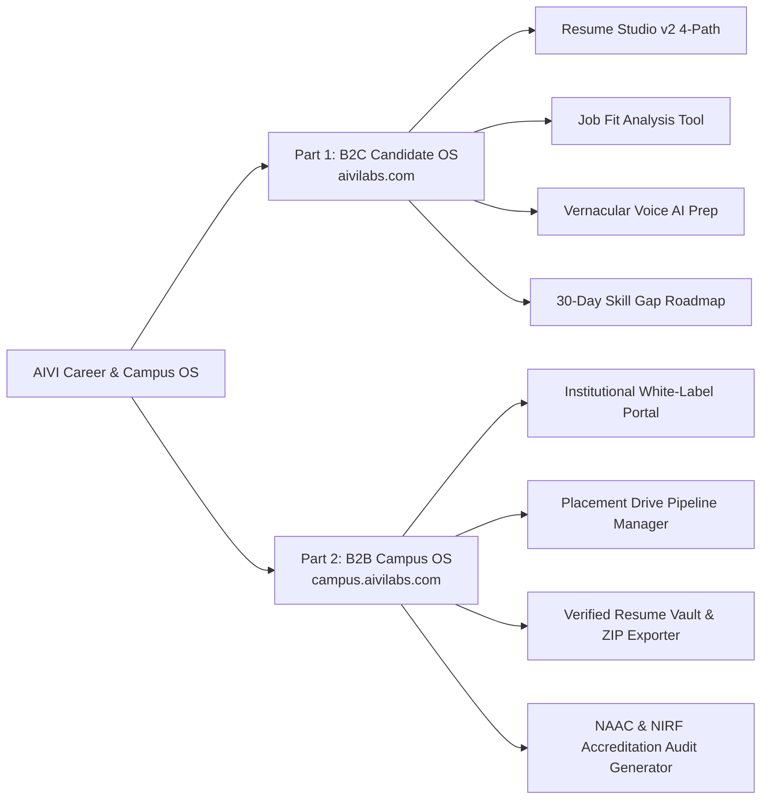

# AIVI Career & Campus OS — Master Sales & Demo Walkthrough Guide

> **Version**: 2.5.0  
> **Last Updated**: August 17, 2026  
> **Authoritative Target Audience**: Sales Engineers, Enterprise Account Executives, Product Consultants & Founders  
> **Live Environments**: B2C (`https://aivilabs.com`) & B2B Campus OS (`https://campus.aivilabs.com`)  

---

## Executive Overview & Pitch Strategy

AIVI is India's first dual-engine **Career Operating System**:

---

## Part 1: B2C Candidate Career OS Sales Demo (`aivilabs.com`)

### 1. Hero Section Above-the-Fold Value Proposition
* **Live Demo URL**: `https://aivilabs.com/`
* **Pitch Narrative**: "Most resume tools generate pretty templates that get rejected by corporate ATS parsers. AIVI is a complete career co-pilot built specifically for Bharat — working professionals, freshers, and final-year students."
* **Key Features Demonstrated**:
  1. **100% Above-the-Fold Visibility**: Primary CTAs **"Build My Perfect Resume"** and **"Try Job Fit Analysis"** require zero scrolling.
  2. **Product Fact Strip**: "6 career modules · ATS + JD analysis · Vernacular Hindi & English · PDF/DOCX reports · DPDP-aligned".
  3. **Trust Badges**: "Data hosted in India · Audio never stored on servers · Single-column Taleo/Workday safe".

### 2. Resume Studio v2 (4 Creation Paths)
* **Live Demo URL**: `https://aivilabs.com/ai-resume-builder`
* **Demo Steps**:
  - **Path 1: First Resume Wizard**: Helps freshers with zero work experience convert college projects and certifications into high-impact bullet points.
  - **Path 2: Quick Edits & Metrics**: Converts passive statements (*"Responsible for sales"*) into quantified achievements (*"Scaled quarterly revenue by 34% across 12 tier-2 cities"*).
  - **Path 3: Targeted JD Keyword Tailoring**: Scans job descriptions and inserts missing technical keywords.
  - **Path 4: Full AI Structural Rebuild**: 1-click overhaul into a single-column, ATS-formatted resume.

### 3. Job Fit Analysis Tool
* **Live Demo URL**: `https://aivilabs.com/job-fit-analysis-tool`
* **Demo Steps**:
  1. Upload candidate CV and paste a target job description (e.g., *Frontend Engineer at Flipkart*).
  2. Display the **0–100% instant match score** and keyword radar.
  3. Show 1-click bridge: Click **"Rebuild Resume for this JD"** to instantly generate a tailored CV.

### 4. Vernacular Voice AI Mock Interview
* **Live Demo URL**: `https://aivilabs.com/interview-intelligence`
* **Demo Steps**:
  1. Demonstrate interactive voice practice in **Hindi**, **Hinglish**, or **English**.
  2. Spoken answer evaluation using the **STAR framework** (Situation, Task, Action, Result).
  3. Reassure candidate privacy: Voice streams are processed in live memory and **audio is never stored on servers**.

### 5. Skill Gap Roadmap & Promotion Readiness
* **Live Demo URLs**: `/career-gap-analysis-ai` & `/promotion-readiness-ai`
* **Demo Steps**: Show 30-day role-specific skill acquisition roadmaps and internal promotion impact statement audit.

### 6. B2C Pricing & Instant Razorpay Checkout
* **Live Demo URL**: `https://aivilabs.com/#pricing`
* **Demo Steps**:
  - **Free Tier** (`₹0`): Basic audit & 1 Job Fit check.
  - **Starter Plan** (`₹399/mo`): Full Resume Studio, 10 Job Fit checks, 2 Mock Interviews.
  - **Pro Plan** (`₹599/mo`): Unlimited Resume Studio rebuilds, 50 Job Fit checks, Vernacular Voice AI.
  - Demonstrate instant Razorpay checkout modal supporting UPI (GPay, PhonePe, Paytm) and Cards.

---

## Part 2: B2B Institutional Campus OS Sales Demo (`campus.aivilabs.com`)

### 1. Institutional White-Label Portal & SAML/OIDC SSO
* **Live Demo URL**: `https://campus.aivilabs.com/`
* **Pitch Narrative**: "TPO officers waste hundreds of hours manually collecting, formatting, and emailing candidate resumes to recruiters. AIVI Campus OS automates placement operations, verifies candidate resumes, and generates NAAC/NIRF accreditation reports in 1 click."
* **Demo Steps**:
  1. Show custom college subdomains (`https://campus.aivilabs.com/campus/login/bit-gorakhpur`).
  2. Show custom branding: College Logo, primary theme colors, and SAML 2.0 / Microsoft Entra ID SSO integration.

### 2. Bulk Student Onboarding & Directory
* **Live Demo URL**: `https://campus.aivilabs.com/tpo/students`
* **Demo Steps**: Demonstrate bulk CSV import wizard uploading 1,000+ student records across departments (CSE, ECE, Mechanical, MBA).

### 3. Placement Drives & Pipeline Manager
* **Live Demo URL**: `https://campus.aivilabs.com/tpo/drives`
* **Demo Steps**:
  1. Create a drive (*Accenture ADC 2026 Batch*).
  2. Manage candidate pipelines across 4 stages: `Shortlisted` $\rightarrow$ `Interview Scheduled` $\rightarrow$ `Technical Evaluation` $\rightarrow$ `Offer Extended`.

### 4. Verified Resume Vault & ZIP Package Exporter
* **Live Demo URL**: `https://campus.aivilabs.com/tpo/vault`
* **Demo Steps**:
  1. Select shortlisted candidates for a company drive.
  2. Click **"Export Verified Resume Pack (ZIP)"**.
  3. Server-side `archiver` streams verified PDF resumes into a single zip archive and emails the download link to the recruiter & TPO via **Zoho Mail India (`smtppro.zoho.in`)**.

### 5. NAAC & NIRF Accreditation Audit Report Generator
* **Live Demo URL**: `https://campus.aivilabs.com/tpo/accreditation`
* **Demo Steps**:
  1. Click **"Generate Compliance Audit"**.
  2. Instantly calculate **NAAC Criterion 5.2.1** (Placement percentage) and **NIRF Metric 3.a** (Higher education & placement progression).
  3. Download official PDF accreditation audit report.

### 6. Institutional Package Tiers & Demo Request
* **Live Demo URL**: `https://campus.aivilabs.com/#demo`
* **Packages**:
  - **Campus Starter** (Up to 1,000 students): White-label portal, Resume Vault, Drive Manager.
  - **Campus Pro** (1,000–3,000 students): Includes Vernacular Voice AI mock interviews & NAAC/NIRF audit generator.
  - **Enterprise Campus** (3,000+ students): Custom SAML/OIDC SSO, dedicated account manager, custom ERP integration.
* **Instant Demo Request**: Demonstrates instant email notification sent to `hello@aivilabs.com` via Zoho SMTP upon form submission.
