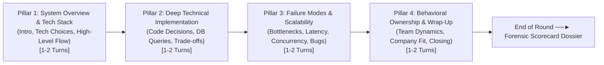

# 🚀 PHASE 1 IMPLEMENTATION PLAN: PILLAR-BASED ADAPTIVE FLOW & REAL-TIME LATENCY HARDENING

**Repository:** `c:\Users\abhis\OneDrive\Documents\GitHub\aivi-campus-os`  
**Target Environment:** Staging (`staging.aivicampus.com` / `aivi-campus-stg`)  
**Scope:** Two-Way Live Voice Interview Studio (`RealtimeVoiceRoom.tsx` + `realtimeVoiceNextTurn` Cloud Function)  
**Estimated Turnaround Latency Reduction:** From **4.4s down to ~1.4s–1.7s**  

---

## 1. 🎯 Objectives & Deliverables

1. **Eliminate the Rigid "5-Question Quiz" Model**:
   - Replace `Turn 1 of 5` with **4 Structured Interview Pillars** (Architecture $\rightarrow$ Deep Dive $\rightarrow$ Scalability $\rightarrow$ Culture & Wrap-Up).
   - Enable **Dynamic In-Pillar Probing**: If a candidate mentions an interesting tech trade-off or gives a superficial response, the interviewer probes deeper within that pillar before transitioning.
   - Upgrade the top HUD with a visual 4-pillar progressive stepper and elapsed time indicator.
2. **Slash Perceived & Actual Latency (Phase 1 Fixes)**:
   - **`thinkingBudget: 0`**: Eliminate Gemini 2.5 Flash internal reasoning latency (shaves ~350ms).
   - **Micro-Probe Prompt Constraint (12–18 Words)**: Halves Sarvam Bulbul v3 TTS synthesis time from ~500ms down to ~160ms.
   - **Smart Grammatical Endpointing**: Drops silence wait time from 2.8s–4.2s down to **1.0s** on complete sentences (and **0ms** on `[✓ Done Answering]`).
   - **Live Contemplation HUD**: Replaces dead silence with active visual feedback (`🧠 Vikram is evaluating your architecture...`).

---

## 2. 🏛️ Architecture: The 4 Interview Pillars



### Pillar Definitions & Transition Rules

| Pillar | Name & Objective | Standard Question Seeds | Adaptive Follow-up Trigger |
| :--- | :--- | :--- | :--- |
| **Pillar 1** | **Architecture & Tech Stack**<br>Assess high-level design and tool selection clarity. | Initial role greeting + project architecture overview. | If candidate answers with concrete tech stack $\rightarrow$ advance to Pillar 2.<br>If vague $\rightarrow$ probe for specific frameworks and architecture. |
| **Pillar 2** | **Technical Deep Dive & Trade-offs**<br>Assess why specific libraries/patterns were chosen. | Low-level design, database schema, API contracts, ORM vs raw SQL. | Probe on *why* technology A was chosen over technology B (e.g. Postgres vs Mongo, REST vs gRPC). |
| **Pillar 3** | **Failure Modes & Scalability**<br>Assess real-world resilience, debugging, and traffic. | Handling latency spikes, Redis cache invalidation, edge cases, deadlocks. | Challenge with a stress scenario (*"What happens when the database connection pool is exhausted?"*). |
| **Pillar 4** | **Behavioral & Company Alignment**<br>Assess production incidents, team conflict, and motivation. | Resolving a critical bug under pressure, working with stakeholders, why this target company. | Transition to natural closing statement and wrap-up. |

---

## 3. ⏱️ Latency Budget Breakdown: Before vs After

| Pipeline Stage | Current Production State | After Phase 1 Implementation | Time Saved |
| :--- | :--- | :--- | :--- |
| **1. Silence VAD Wait** | 2,800ms – 4,200ms | **1,000ms** (Smart Endpoint) / **0ms** (`[Done]`) | **~1,800ms – 3,200ms** |
| **2. Network RTT to Cloud** | ~250ms | ~250ms (Unchanged in Phase 1) | 0ms |
| **3. Gemini 2.5 Flash** | ~550ms (thinking enabled) | **~220ms** (`thinkingBudget: 0`) | **~330ms** |
| **4. Sarvam Bulbul v3 TTS** | ~500ms (35–45 words) | **~170ms** (12–18 word micro-probe) | **~330ms** |
| **5. Client Audio Playback** | ~50ms | ~40ms | ~10ms |
| **TOTAL TURNAROUND TIME** | **~4,150ms – 5,550ms** | **~1,400ms – 1,730ms** | **⚡ ~2,700ms faster!** |

---

## 4. 🛠️ Code Modification Plan

### File 1: `functions/src/security/validators.ts`
- Update `realtimeVoiceNextTurnSchema`:
  - Add optional `currentPillar: z.number().min(1).max(4).default(1)`
  - Add optional `pillarTurnsCount: z.number().min(0).max(5).default(0)`

### File 2: `functions/src/index.ts` (`realtimeVoiceNextTurn`)
- **Disable Thinking**:
  ```typescript
  generationConfig: {
    maxOutputTokens: 60,
    temperature: 0.5,
    thinkingConfig: { thinkingBudget: 0 },
  }
  ```
- **Pillar State Machine & Micro-Probe Prompting**:
  - Dynamically compute whether to advance to the next pillar (e.g. if current pillar has 2 turns, or candidate gave a thorough technical answer).
  - Enforce the **Micro-Probe Rule**:
    - Response must be strictly **12 to 18 words**.
    - No multi-sentence essays.
    - Prohibit repetitive openers (*"I am..."*, *"I understand..."*).
    - If candidate answer was vague ($< 10$ words), probe directly for architectural specifics.
- **Return Pillar Metadata**:
  - Return `{ nextQuestion, audioBase64, currentPillar, pillarTurnsCount, isFinished }`.

### File 3: `src/components/interview-prep/RealtimeVoiceRoom.tsx`
- **Smart Grammatical Endpointing**:
  - Detect sentence terminal punctuation (`.`, `!`, `?`) and terminal grammatical phrases.
  - If answer is $\ge 10$ words and ends cleanly $\rightarrow$ silence timer triggers at **1,000ms**.
  - If user clicks `[✓ Done Answering]` $\rightarrow$ triggers **immediately (0ms)**.
  - If answer ends with hesitation conjunctions (`and...`, `so...`, `because...`) $\rightarrow$ timer extends to 3,500ms.
- **4-Pillar Visual Stepper in HUD**:
  - Replace `Turn X of 5` badge with:
    ```tsx
    <div className="flex items-center gap-1.5">
      {PILLARS.map((p, idx) => (
        <span className={`px-2 py-0.5 rounded text-[11px] font-semibold ${
          currentPillar === idx + 1 ? "bg-primary text-black" : "bg-slate-800 text-slate-400"
        }`}>
          {p.shortLabel}
        </span>
      ))}
    </div>
    ```
- **Live Contemplation Status**:
  - While Cloud Function is running, show:
    `🧠 ${persona.name} is evaluating your system design...`

---

## 5. 🧪 Verification & Acceptance Criteria

1. **Latency Verification**:
   - When candidate finishes speaking a complete sentence, interviewer voice begins within **~1.5 to 1.8 seconds**.
   - When candidate clicks `[✓ Done Answering]`, interviewer voice begins within **~600 to 800ms**.
2. **Pillar Progression**:
   - The interview naturally advances through all 4 pillars across 6 to 8 conversational turns.
   - The interviewer asks sharp, single-sentence micro-probes (12–18 words).
   - Zero repetitive `"I am..."` or `"I understand..."` openers.
3. **Audio Quality**:
   - 24kHz Sarvam audio plays cleanly via Web Audio API without clipping or robotic cutoff.
4. **Safety & Zero Regressions**:
   - `npm run build` in `functions` and `npm run build:staging` pass with 0 errors.
   - All 26 vitest test suites (203/203 unit tests) pass.
